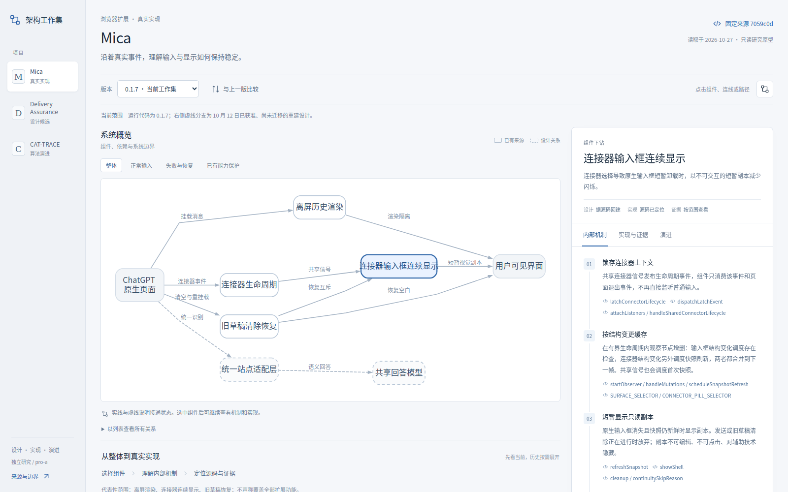
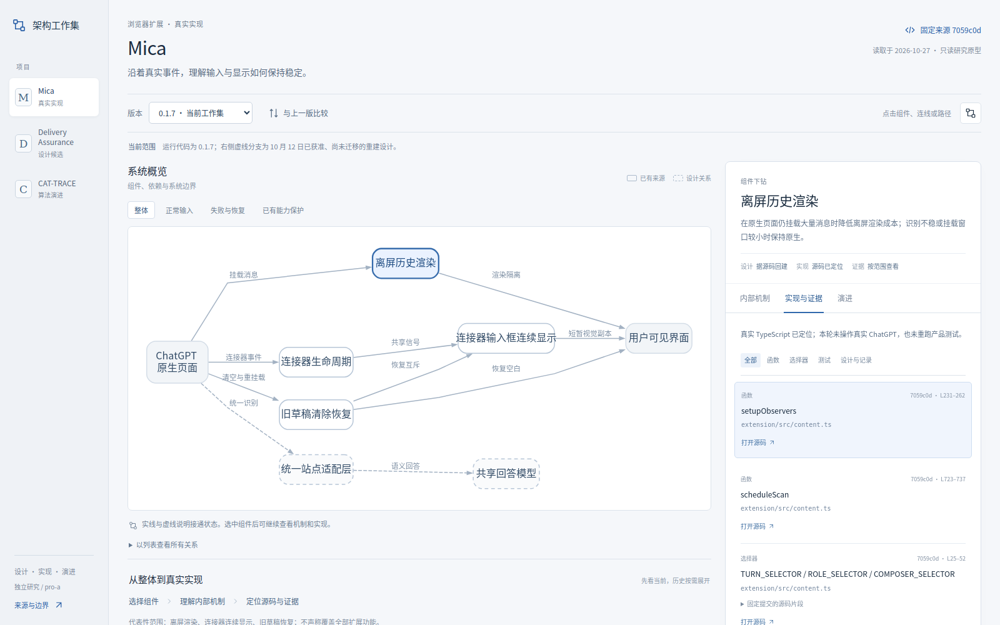
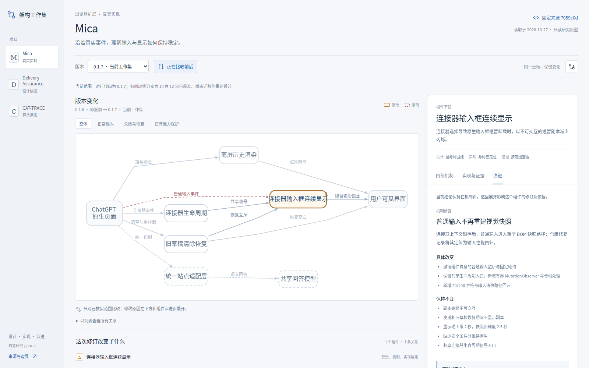
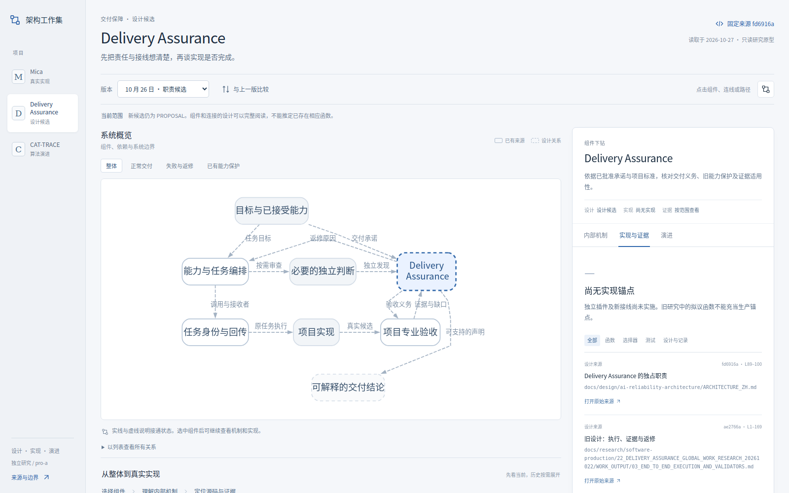
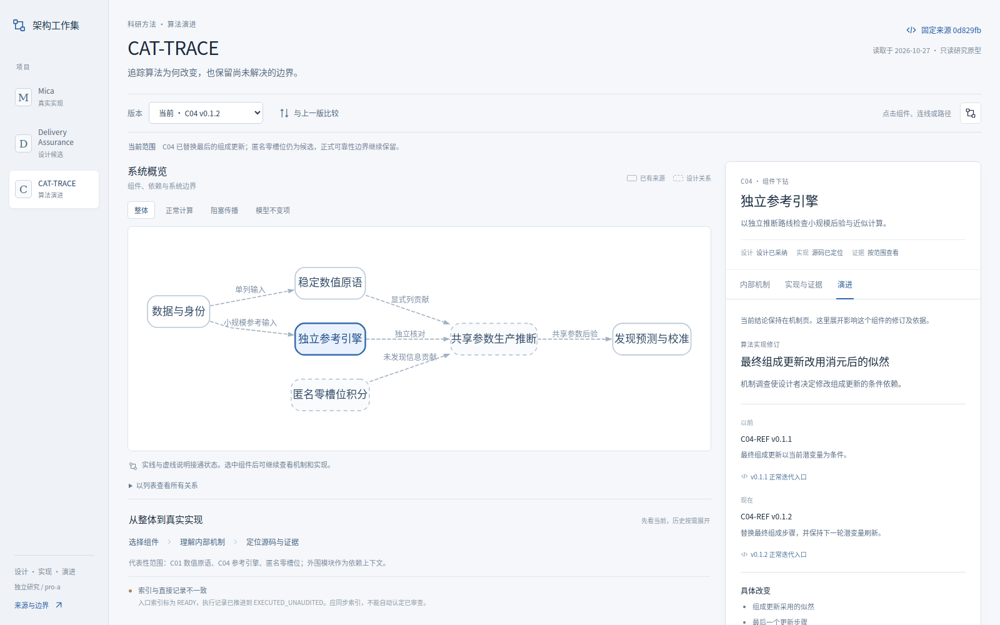

# 架构工作集：可离线打开的研究原型

打开 [index.html](index.html) 即可。下载这一文件后双击，用现代浏览器阅读；图、数据、样式和脚本已经包含在文件中。没有网络请求、账号、服务器或运行时依赖。源码外链需要网络及原仓库权限。GitHub 文件页只显示源码，不等于网站已经部署。

## 建议走读顺序

1. **Mica 当前架构。** 选择“连接器输入框连续显示”，阅读真实事件、观察范围、快照、互斥和恢复机制。点函数按钮，继续到固定提交的真实文件。
2. **Mica 机制修订。** 切到 0.1.6，确认旧普通输入触发与旧源码；再打开比较，看到 1 个组件、1 条关系的变化。共享生命周期入口原本就存在，保留为不变关系。其他组件只作当前上下文。
3. **DA 的未实现设计。** 切换 Delivery Assurance，阅读完整设计与两版职责。实现页明确“尚无实现锚点”；没有虚构生产函数。失败路径说明 workflow-core 与 Bridge 的分工。
4. **CAT 的算法演进。** 选择 C04，阅读消元及迭代步骤、真实 routine、前后实现与正式可靠性边界。再看匿名零槽位的撤销原因和当前 blocker。
5. **手机阅读。** 默认按可点组件与关系列表阅读，同一数据支持选择与下钻；可展开横向图，不把桌面图缩成难读的小字。

局部历史的范围始终显式显示。当前工作集是截至指定提交的研究映射，不是实时仓库状态。

## 重建与检查

需要修改模型或页面时，在本目录执行：

```bash
npm ci --ignore-scripts
npm test
npm run build
```

需要 Node.js 20 或更新版本。唯一构建依赖是锁定的 `@viz-js/viz 3.25.0`，内含 Graphviz 14.1.3。Graphviz 在构建时生成 SVG，阅读页面不包含布局引擎。使用本任务已有运行环境时，`build.mjs` 也支持从 `CODEX_PRIMARY_RUNTIME_NODE_MODULES` 定位现成依赖；普通使用者无需设置该变量。

已有冻结模型时，可以额外检查历史是否被覆盖：

```bash
node build.mjs --baseline /path/to/previous-frozen-data.json
```

它拒绝修改或删除已冻结的修订、变更原因、来源锚点和证据。新事实用新记录和新身份追加；该本地能力没有安装远端 CI 门禁，也不自动赋予冻结权。

模型检查使用 Node 原生测试，无测试框架依赖。可选浏览器 QA 另外需要 Playwright 与 Chromium，均不属于页面或构建的运行依赖：

```bash
QA_PLAYWRIGHT_MODULE=/path/to/playwright \
QA_BROWSER_EXECUTABLE=/path/to/chrome \
node tests/ui.test.mjs
```

默认以 `file://` 打开本地 `index.html`。中文字体由测试机器提供；本轮在隔离的字体配置中使用 Noto Sans CJK SC。没有把浏览器、字体文件或缓存提交到仓库。实际环境、检查范围和输出摘要见 [QA.md](QA.md)。

## 文件结构

| 文件 | 作用 |
| --- | --- |
| [model/data.json](model/data.json) | 三个项目的人工核实研究切片；同一六对象模型 |
| [model/README.md](model/README.md) | 字段、状态、局部历史和不可变来源约定 |
| [model-core.mjs](model-core.mjs) | 结构差异、影响传播、记录校验及有范围的规则示范 |
| [build.mjs](build.mjs) | 生成并集图、校验 SVG 绑定、打包离线文件 |
| [app.js](app.js) / [styles.css](styles.css) / [template.html](template.html) | 通用阅读与交互，不按项目硬编码页面 |
| [generated](generated/) | SVG、DOT、构建记录、测试与浏览器记录；均可重新生成 |
| [screenshots](screenshots/) | 七张实际浏览器截图 |

不要直接编辑生成的 `index.html`。修改数据或界面源码以后重新构建，并核对相应真实交互。

## 已有功能与明确边界

已有功能包括三项目切换、系统关系选择、正常／失败／保护路径、机制内容、准确来源定位、历史切换、范围化差异、组件因果记录、并集影响候选和无实现状态。13 项模型检查与 14 项有限 UI 检查的实际结果均已保存。

源码锚点由本轮实际读取固定仓库后整理。构建器检查这些记录的相互一致性，没有重新联网证明源文件存在；自动 AST 解析、跨仓同步、任意重命名修复与通用 Markdown 内容提取尚未实现。运行证据适用性和片段重定位是有反例的规则演示，没有接管真实产品或科研验证。

设计正文的正式来源仍在各原项目。本轮 JSON 中的解释是研究切片，不主张将来再人工维护一份重复的产品全文。正式试点应把可复用内容绑定到原文，并测量额外维护成本。

### 实际截图











其余两张 [Mica 手机截图](screenshots/mobile-mica.png)、[DA 手机截图](screenshots/mobile-da.png) 展示同一模型的紧凑阅读方式。
