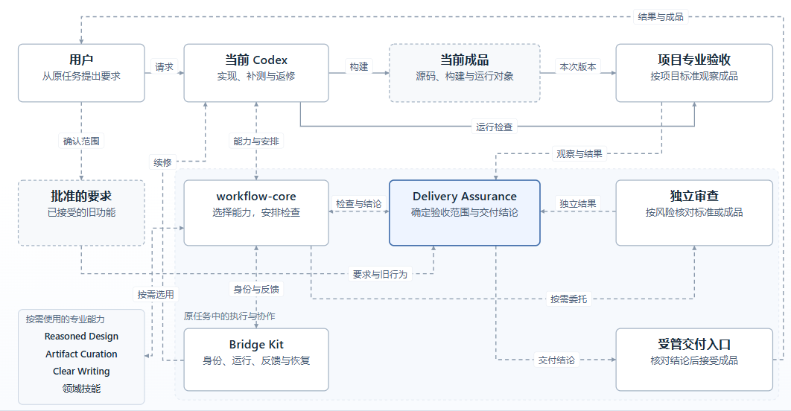
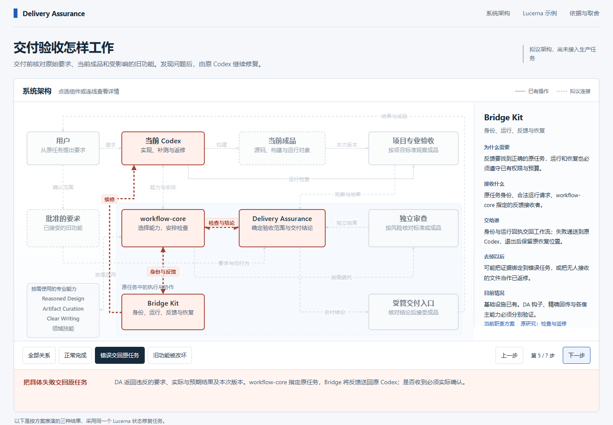
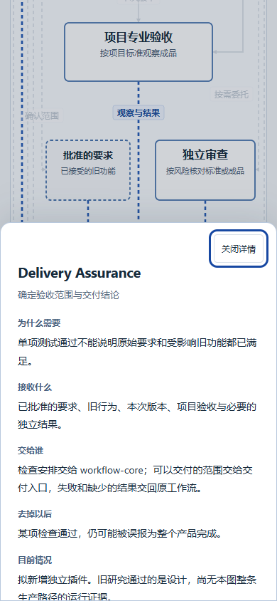

# 实际浏览器截图

全部来自最终单文件原型，具体源码与图片 SHA-256 见 [浏览器记录](../checks/browser-report.json)。桌面为 1440×1000，手机为 390×844；长图完整保留页面高度。图像是可交互网页的真实渲染，不是绘图工具中的假界面。

| 内容 | 图像 |
| --- | --- |
| 完整架构图 | [architecture.png](architecture.png) |
| 桌面首屏 | [desktop-overview.png](desktop-overview.png) |
| 组件与上下游 | [desktop-component.png](desktop-component.png) |
| 连接的载荷与消费者 | [desktop-connection.png](desktop-connection.png) |
| 故意错误被项目检查发现 | [desktop-failure.png](desktop-failure.png) |
| 失败返回原 Codex | [desktop-repair.png](desktop-repair.png) |
| 新功能正常、旧入口坏了 | [desktop-regression.png](desktop-regression.png) |
| 完整网站，依据全部展开 | [complete-website.png](complete-website.png) |
| 手机首屏 | [mobile-first-screen.png](mobile-first-screen.png) |
| 手机完整页面 | [mobile-overview.png](mobile-overview.png) |
| 手机组件详情 | [mobile-component.png](mobile-component.png) |

