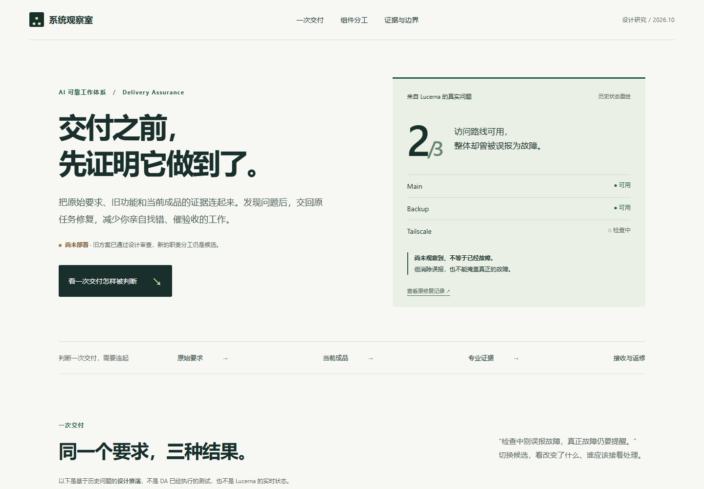
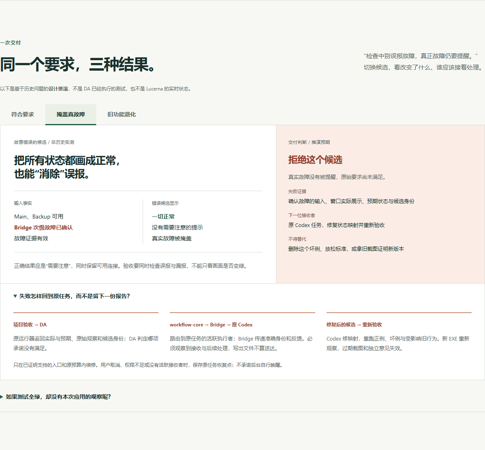
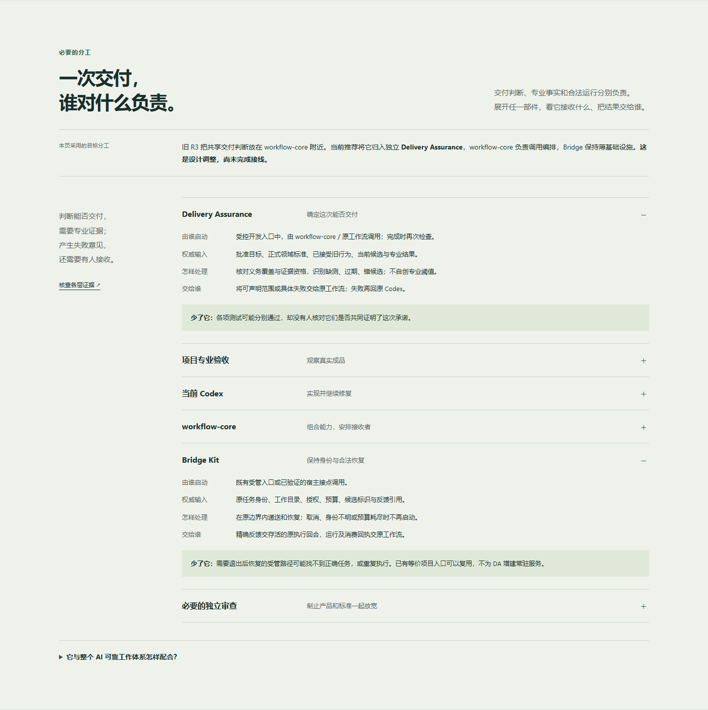
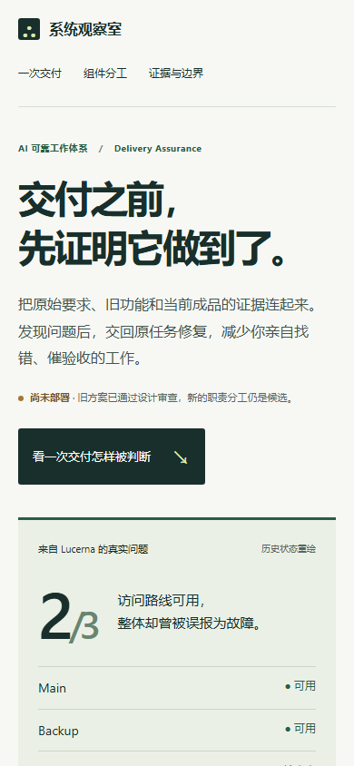
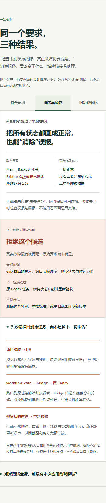
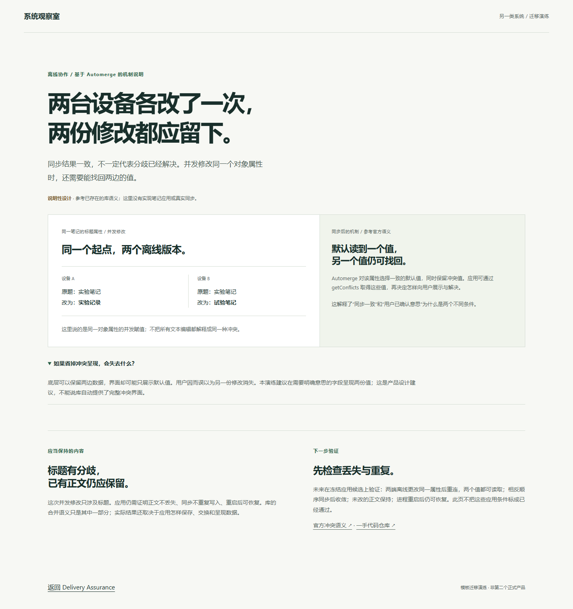

# Delivery Assurance · 可审阅视觉原型

浅色编辑式页面，从真实误报进入，比较三种候选，再查看各层责任、证据与投入。所有页面内容均为实际中文成稿，无 lorem ipsum 或待填占位。

**这是设计原型，尚未部署。** GitHub 可以直接展示以下 PNG；GitHub 的 HTML 文件页展示源码，不执行交互。下载 [静态原型包](../prototype-bundle.zip) 并解压，直接打开其中 `prototype/index.html`，即可切换候选、展开组件与失败回传。无安装、构建、账号或联网运行要求；只有主动点击来源时访问外部网站。

[完整决定](../DESIGN_DECISION.md) · [完整中文及证据](../DA_STORY_AND_EVIDENCE.md) · [作者核查及边界](../VISUAL_QA.md) · [HTML 源码](index.html)

## 桌面首屏

1440 × 1000。用途、设计状态、真实案例与主要阅读入口同时出现。右侧是有来源的历史状态重绘，不是 Lucerna 应用截图。

[查看桌面完整长页](previews/desktop-full.png)

## 关键机制：错误候选与原任务返修

同一要求下，把所有状态画成正常会掩盖真实故障。面板将输入、错误展示、拒绝理由和真实消费者并列，返修链默认展开。全部是设计推演，没有运行 DA。

## 组件的存在理由

DA 与 Bridge 已展开；其余按需展开。输入、处理、输出消费者和删除损失在同一处查看。旧 R3 与当前推荐分工的差别始终可见。

## 移动端

390px 宽，单列按因果顺序阅读，常用按钮和导航至少 44px 高。完整长页与失败展开均来自实际浏览器渲染。

| 首屏 | 失败与返修 |
| --- | --- |
|  |  |

[查看移动完整长页](previews/mobile-full.png)

## 另一类系统的迁移

[离线并发编辑页面](transfer.html)复用同一 CSS，用两台设备的输入与同步后读取解释 Automerge 属性冲突。没有 DA 角色、运行日志或七仓术语，没有执行 CRDT 库。

[查看另一系统移动端](previews/transfer-mobile.png)

## 可复核范围

[browser-checks.json](browser-checks.json)记录本地 Chromium 版本、行为与宽度检查、四个页面源文件的 SHA-256；[verify.cjs](verify.cjs)可在已有 Playwright 与 Chromium 的环境复跑，运行 `node verify.cjs` 会更新截图和检查报告。阅读原型本身不需要这些工具。

目前完成作者视觉自查与浏览器行为核查；未做跨浏览器、屏幕阅读器和独立读者理解测试。这些结果不能被引用为 DA 产品的运行验收。
