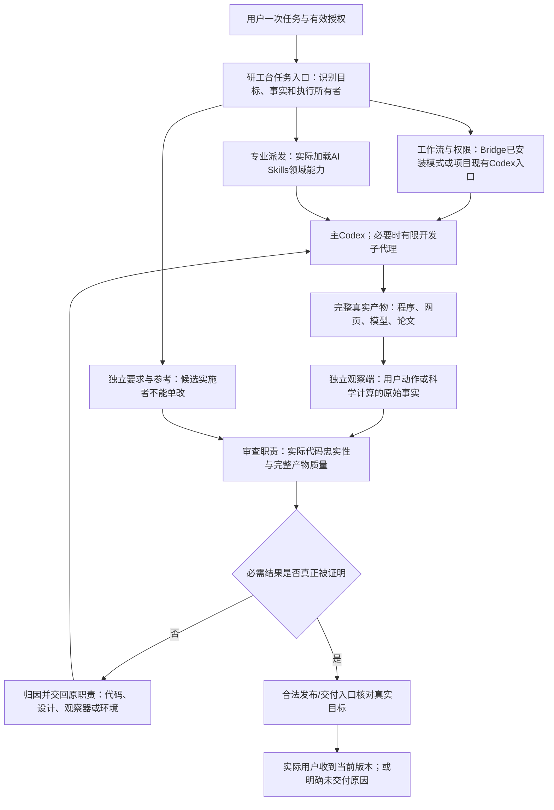
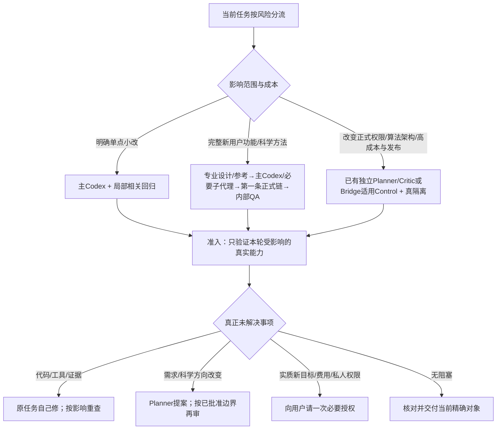

# 第一卷　研工台到底是什么：运行架构、具体组件及其执行合同

本卷是2026年10月13日提出的待认可架构，不是已安装程序，不是部署报告，更不是独立审查通过。架构研究依据既有六仓库246条登记和CARE两批归因，必须先解释错误在哪条真实执行链发生，再决定应该增加什么最小程序。所有新模块的名称都在正文标记“拟建”；现有Bridge、Codex、技能、项目脚本则必须按目标机器真实安装版本消费。

## 一　先讲最终形态：一个任务入口，四类执行程序，两个独立责任域

用户说“为Lucerna加一项完整功能”或“做一个新的医学影像学习方法”，不应该再手动告诉五个角色分别做什么。研工台拟议为安装在有授权的开发环境中的有限任务运行包，对外提供“继续当前任务、查看真实进展、按已批准计划进行下一步、交付当前已验候选”等入口。它不是一个新的主模型，不自行训练医学模型，也不重新实现Windows截图、Zotero、Playwright或Slurm。单个用户目标的真实需求仍归项目有效Goal、用户决定和原始科研/产品文档；执行位置、授权和现有复杂角色状态归Bridge或项目原正常入口。

关键不是多设计几个框，而是任一边必须能找到当前真正调用者、真实输入、观察产物和失败后接手人。如果一个箭头只存在于Goal文字里，没有实际运行入口，就只能记录“未接通”，不能说闭环完成。

这里必须区分两层身份。上层是一项用户交付任务：“Lucerna的R2提醒完整可用”。下层是一次或若干次有权限的Codex/Bridge执行：“修改模块、运行测试、独立复核”。上层不能重写Bridge的CURRENT、预算或执行授权；下层的一个提交也不能宣称上层产品已可使用。没有已安装的Bridge Reviewed/Control的产品，可先借当前合法Codex任务入口运行一个有限执行包；不得以“统一”为由替六仓库默认安装所有Bridge模式或常驻后台。

## 二　真正需要多少个程序？

建议只有四组公共能力，内部是十二个可测试职责，而不是十二个常驻代理。一个小修复可能只运行其中三四个函数；重大新功能或科研模型才触发专业设计、独立观察与必要正式审查。

### 组件一：真实任务定位器（拟建）

入口：已有项目Goal或Issue、当前Git分支与工作树、用户本次要求、已批准权限。拥有者：研工台任务入口。动作：核对任务唯一性、来源版本、已有完成能力、真实代码与运行目标；发现同义任务不新建，已达目标返回无需重复。输出：当前任务源和仅受本次影响的必需能力。失败：目标冲突、源码与任务不是一个工作树时暂停，不让Codex猜路径。验证：Bobbio允许develop、Mica活动重构分支、CARE的main与develop事实不能被统统改成main；多任务同时编辑同资源时必须正确拒绝第二写者。

### 组件二：用户能力与科学含义解释器（拟建）

输入：原产品设计、Figma、原论文/公式、数据人群、已接受用户行为和有效修订。动作：把“做一个功能”落实成完整用户路径、异常/取消/重入与旧功能保护，把“做一种模型”落实成真实训练数据、前向、有效标签、优化目标、推理与比较口径。输出：可追溯的义务视图和“允许等价内部实现”的边界。这里模型可以协助理解，但是**当前Executor不得单独减少义务集合**。坏例：仅新增Lucerna设置卡片却没有读取/提醒，或CARE原方案要求跨模态机制却用现成baseline冒充新机制，都不达到原承诺。合法例：科研可行性试验按已批准前置失败条件停止，不被错判为偷懒。

### 组件三：检查计划与资源选择器（拟建）

输入：义务集合、修改影响、历史同类失败、平台实际能力、权限和资源预算。动作：选择最少仍足以证明本轮声明的检查，形成“正常输入、错误、边界、旧功能、独立专业观察”的完整集合；把公开开发检查、正式受保护检查分开。输出：明确场景ID、现有脚本或待补观察以及为何必须运行。拒绝条件：为了降低成本删除相关旧行为、把真实平台要求换成结构检查、把未知数据换成0、把视觉审查换成截图文件存在。反面轻量案例：只改一个文案时不启动全量Windows安装/GPU/复杂Critic。

### 组件四：专业能力派发器（拟建）

真正调用者是**任务入口所属程序**，不是Planner的Goal里一句“请调用插件”，也不是Executor自己说读过。它先在合法目标机器确认实际Codex身份、技能安装路径、版本和本轮适用性，再用已安装的正式触发方法启动专业阶段。例如新增CUHK Date问卷：第一轮使用当前前端设计技能对真实页面决定结构和状态；第二轮用产品界面文案技能处理香港繁体与内地简体；实现后以真实网页检查消费结果。例外：一处简单拼写不必启动所有技能。若查无技能，不能静默降级为无领域能力的通用模板；报告专业路线缺口或交已有合法维护者修复。**实际加载事件只证明“调用过”，不证明“用得好”，成品还要经观察。**

### 组件五：实施与子任务集成适配器（复用现有Codex/Bridge，少量拟建封装）

默认一个主Codex有写入权和最终集成责任。主Codex可以在明确不重叠的文件、接口和测试范围内调用子代理：例如Lucerna的纯阈值逻辑与设置组件分开；CARE正式采样和独立数学开发测试分开。但共享业务状态、训练入口、最终loss和完整用户路径由主Codex集成。子代理自报完成不能直接升级上层任务。拟建封装只检查主进程/工作树/权限与各子任务真实合并，不复制Codex SDK、Bridge watcher、审批机制。没有已验证执行主机时不能标记任务正在运行。

### 组件六：第一条纵向生产链检查器（拟建统一协议，调用既有项目脚本）

这是防降级中最早的核心。它不要求完整成品已漂亮，却要求“本次宣称的核心资源真的进入正式路径并影响结果”。Lucerna应能在合法受控HTTP响应下，从CloudflareR2Provider::refresh一路经过正式解析、聚合、显示和通知。CARE应能从正式case loader读入真实训练数据，按约定样本/模态有效性进入真实loss，再影响所要求参数，保存后正式恢复下一步。Asteria的深层图布局、医学模型的多尺度特征都要从真实消费者观察，不靠文件里的模块名。此检查发生在大量编码或昂贵训练之前，若发现假链立即返回实现，不把“训练很久”或“截图很多”当工作信用。

### 组件七：独立参考与验收集合管理（根据现有Reviewer/Verifier复用，公共核对拟建）

时间上先明确原要求，随后实现；公开的能力/测试可以给开发者看，受保护的是正式判定修改权、独立数学参考、最终未见输入的具体实例和验收者的结果存储。对CARE数学loss，从原公式构造不调用生产loss helper的简化数值/梯度参考；对CUHK Date，从可见浏览器表单与真实账号状态构造后置条件，不直接用接口调用替代用户操作；对Asteria，用真实屏幕坐标加完整科研图阅读判断，恒零碰撞计数不能通过校准。若某项目原本有Bridge Control Verifier，继续由它拥有最终验收合同，不再多添第二个Verifier。

### 组件八：真实观察执行器（拟建薄适配，调用项目已有程序）

观察器本身不靠模型推理判真，它调用固定已批准的程序：Lucerna原生接受脚本、Bobbio隔离Zotero往返、Mica真实扩展/宿主、SeminarArc黑盒APK、Asteria浏览器与图形测量、CUHK Date托管可见表单、CARE实际采样/前向/推理/指标。输出包含原始输入与动作、进程/设备/包身份、后置结果、错误类别和确切证据。检查器运行在有权限的安全环境，不能为了“独立验收”访问用户正式桌面、生产凭据或私人数据；缺真正安全环境时标未验证，不造“已测试原生”的假回执。

### 组件九：代码忠实性与专业整体审查（复用合法Review/Control阶段，Lite按需有限审计）

两个问题分开：实现是否忠实原义务；整体成品是否真的可用、可读、有专业价值。只读审查Codex必须由外层已授权任务入口/Bridge原有角色启动新上下文，读原始要求、同一候选和独立观察，而非接受实施者的P1=0。对复杂界面还应读取真实全屏、状态、交互、Figma；对科研模型必须读公式/真实结果，不能只盯测试通过。**另一模型并不自动独立**：若还是同一管理员权限可改验收器、同一共享证据包可被实施者改写，仍只能称内部审计，不得称技术性强制隔离。独立审查遗漏要用历史坏例与正确例校准，而不是让两个同模型投票。

### 组件十：声明准入与实际交付核对器（拟建）

输入：原义务、必需检查是否真的运行、同一语义候选与实际安装/预测/部署身份、独立审查结论和批准发布目标。输出只允许五类含义：确实证明了本阶段、实现未满足、观察器失效、环境/权限缺口、等待真正人类决定。所有核心检查缺失/skip/错候选/旧图/假指标不能升级到用户成熟交付。程序不得仅凭退出码0、绿色GitHub汇总、对得上的SHA或报告PASS相信其因果内容；必须读取实际产物与动作。发布前查询目标真实状态，已发布正确版本则无需重复。

### 组件十一：失败归因与有界恢复（复用Bridge生命周期；薄分类拟建）

原任务出现失败时，先分：代码、设计、验收器、数据与环境、证据传输、授权/费用、科学负结果。可复现代码错回主Codex，测量器错回测试owner，原合同解释交Planner，真正新增目标/费用/权限才给用户。默认一个正式审查批次集中发现，同一目标修复后按影响复核；同因没有新机制证据就停止第三次相同昂贵全套检查，不换任务名或提交哈希重置预算。已有Bridge Review/Control严格预算优先，不允许研工台外套循环越过人类出口。外部动作结果不明时查真实目标，不直接重发安装、部署、消费一次性票据或Slurm作业。

### 组件十二：AGENTS与专业规则维护（已有项目规则为权威；维护派发拟建）

每次任务起点扫描当前有效AGENTS链、override、作用域、路径和实际加载配置。任务影响到入口/平台/插件时或真实事故关闭时，自动触发一轮有限整理：保留、修订、去重、下移、迁移成可执行检查、退休或归档。单纯格式/同步已批准路径可在合法任务范围整理；改安全边界、科学目标、正式及格线须原权威批准。规则存在而程序还能反复抢用户桌面，应修Host权限和图形会话实际隔离，而不是写第五条同义提醒。新规则必须在后续正常Codex运行入口真实加载并影响行为，才算维护完成。

## 三　什么时候启动哪些角色，谁有权决定

单纯代码自检可与主Codex同责任，并不一定再启动第二个模型。正式独立审查只有存在实际可调用入口、审查者有足够原始材料、受保护评分源与足够运行事实时才宣称完成。GPT Work用于最终完整产品质量的独立盲区发现，而不是代主Codex第一次认真点击按钮或发明截图流程。

## 四　插件、Bridge、项目、研工台分别拥有哪一个权力

| 归属 | 负责的实际决定 | 不许侵占的责任 |
|---|---|---|
| 用户/项目原要求 | 目标、科学问题、已接受行为、必要的授权 | 不承担每次普通测试或截图搬运 |
| Planner/适用Critic | 重要设计及合法修订的解释与批准 | 不能声称代码还没写就已经验证 |
| AI Skills领域插件 | 前端设计、产品文案、统计建模、医学影像等专业方法 | 调用过不等于真实产物专业正确 |
| 主Codex与子代理 | 实现、集成、开发者自检、定向返修 | 不能删用户义务、改独立参考、签发正式通过 |
| Bridge Kit Host/Lite/Review/Control | 当前执行位置、授权、阶段、工作树、过程恢复与角色合法入口 | 不重新实现每项目的专业验收，也不让研工台增加平行CURRENT |
| 各项目脚本与领域质量负责人 | 原生桌面、浏览器、数据、训练、图形/文案实际观察 | 测到局部机制不能把全部用户产品判完美 |
| 研工台薄运行包 | 在正常入口真正派发专业/实现/观察/恢复，保持同一任务最终可交付 | 不重写领域算法、项目代码、Bridge状态机或额外昂贵常驻平台 |

## 五　怎样落地而不再造庞大中央机器

第一版先在Lucerna正常开发入口接最小真实产品路径与内部观察，再复用CARE已有纯CPU历史坏例做反证（无新GPU训练）。证明这套准入能抓旧坏例、能放行好例并且不需要用户第一轮查P1，才论证应分发公共包。第二个不同平台按现有成熟度优先Mica扩展或Asteria网页，验证公共任务/证据/归因部分能共用而专业脚本留本地。不能因为“跨项目通用”就让每个仓库改分支策略、安装全套Bridge或新增十个长期进程。必要新权限、长期Runner、付费API、用户个人数据和Windows GUI会话另行明确合法授权；本轮未实施。

**这套东西仍是工程架构，不是成熟运行产品。** 三条最严验收同时成立才值得继续：实际错实现被正式入口抓住、正确完整实现得到真实交付、普通任务额外负担和用户介入明显降低。若只多出结构文件/审计回执或更多模型使用量，这条路线应被否决。
