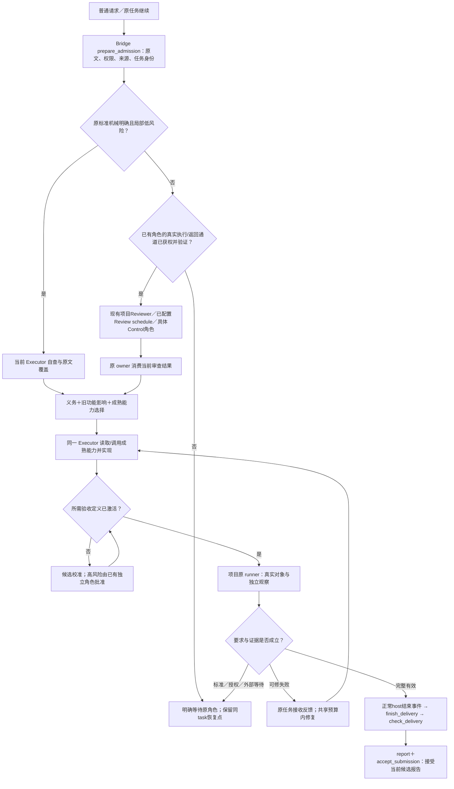

# Delivery Assurance：让原任务承担验收和返修

用户发出正常功能请求后，系统应自己核对要求、使用合适的成熟能力、保护旧功能、验真实成品，并把失败送回原任务修复。用户不应反复提醒验收、搬运失败报告，或成为第一个发现假完成的人。

推荐仍是 **Bridge 的已有入口＋workflow-core 的小共享库＋七仓已有专业验收**。独立 Critic R3 已对包7ca0f0f2、源79fe13a6给出设计PROCEED：DA-AR-01/04关闭，02/03/05保留关闭。本轮不改冻结技术语义，只增加[可读图与完整解释](11_ARCHITECTURE_EXPLAINED.md)和[分阶段实施审查稿](12_STAGED_EXECUTION_REVIEW_PACKAGE.md)。设计通过不代表生产实现、宿主实测或执行授权；状态以[CURRENT](CURRENT.md)为准。

已确认边界不再提问：受支持正常 Codex 入口自动接入；受管交付必须真实验收；Hook 完全缺席时不保证撤回已经生成的原生聊天错误文字；不造新客户端、常驻调度器、第二任务库、第四工作流或万能评分器。

## 1. 一项普通请求怎样到达可信交付

这张图中的新增调用都是设计，不代表今天已接通。没有活跃 owner 时，只保存原任务恢复点，不画虚构的自动唤醒；没有原授权就不启动账号、设备、GPU或部署。

以 Lucerna 为例，用户要求刷新真实用量并保留旧配额。写产品前，独立角色要从原话确认“可信来源、当前账号、缺值不能编零、旧功能不退化”，不能只审 Executor 的摘要。Executor 读取适用设计/状态能力，再补缺失检查。检查程序先接受冻结好例、坏例、缺证例、旧功能例校准；新的观察方式须独立准入，获准的准确版本才可验产品。当前EXE上的刷新、旧配额和独立原生审查全部成立，正常host的Stop或父进程退出检查才接受统一交付报告。仅修既有明确状态映射可走SELF；新来源/余额语义必须独立。角色文件存在不代表已运行；本机Reviewer需具体获权调用，Review需实际scheduler与接收者。

固定显示680的坏实现即使过第一输入，第二个不同用量会失败；反馈携带实际/期望、候选、原要求和允许修复范围回原任务。旧功能则从变化前后的入口和依赖图反查，不能因为手写adapter漏了Codex额度就不保护它。更完整的 Android 持久化和 CARE 科学负结果链见 [03联动核验](03_END_TO_END_EXECUTION_AND_VALIDATORS.md#r1-integration) 与 [04逐仓合同](04_SEVEN_REPOSITORY_ADOPTION.md)。

## 2. 为什么只保留这三个实现位置

只补七仓脚本更便宜，但会继续重复身份、原要求覆盖、反馈消费和交付判断；建立中央平台又会增加运行状态和维护负担。因此选择薄连接，并以首片实际减少漏检和用户搬运作为保留理由。

|位置|解决的具体问题|实际调用与接收|维护与失效|
|---|---|---|---|
|Bridge 原入口增量；delivery.py / delivery_hooks.py|漏准入、失败无人接、错线程恢复、报告绕过|run_lite_task / run_codex_event / 原Control preflight /可信Hook调用prepare_admission；当前任务或原父进程消费；正常host调用finish/check/report/accept_submission|Bridge维护入口、身份、锁与真实接收；缺能力不启用，不建新daemon|
|workflow-core delivery_core.py、同一da/2 schema和fixtures|原要求/旧功能遗漏、未激活检查签交付、不同候选拼绿|decide_admission_route、compile_obligations、select_checks、select_execution_capabilities、validate_definition_admission、validate_result、evaluate_claim；返回给Bridge|纯函数，不运行设备/模型/领域评分；缺标准、未知边或required证据保持未证|
|项目既有runner与小adapter|机械PASS冒真实成品、专业判断失真|原runner产生真实观察和专业结果；04明确每仓原结果路径与独立输入；Bridge在正常完成接点统一形成claim|项目维护标准、控制集、旧行为与结果转换；首次adapter和正式出口变化必须准入|

K1–K5仍只是身份、义务、专业检查、交付、反馈五组职责，不是五个服务。36职责、315问题、83旧要求和363历史是反向核对材料，不决定模块数量。删掉准入会重现理解错还全绿；删掉激活会让产品作者自造测试自签；删掉最终消费者则独立结果可以永远没人读。

## 3. 两项返修与三项保留机制

|稳定意见|已选机制与具体消费者|为什么不能用更轻的口头约定代替|
|---|---|---|
|DA-AR-01|[实际独立调用](03_END_TO_END_EXECUTION_AND_VALIDATORS.md#r2-ar01)：简单机械任务SELF；新高风险由既有获权角色独立重建。本机有限调用同步返回，已有Review schedule补首轮PLAN_REQUESTED处理；缺合法通道明确非自动，不能用创建文件代执行|逐字覆盖抓不到误解；不能把所有任务都升级Control，也不能让事后Reviewer冒事前检查|
|DA-AR-02|[DefinitionAdmission](03_END_TO_END_EXECUTION_AND_VALIDATORS.md#r1-ar02)：候选→校准→精确摘要激活；submit/calibrate/activate及check实际消费；adapter同准入|登记“owner”没有批准效果；换一个agent也不产生独立性。冻结控制的低风险机械检查无需额外模型|
|DA-AR-03|[Resolution.execution_capabilities](03_END_TO_END_EXECUTION_AND_VALIDATORS.md#r1-ar03)：任务相关性、真实版本、Executor读取/调用、实现影响、缺失限制|只有验收清单会放任低配方法先实施；已有等价项目能力优先，纯后端/普通文档不触发全套前端|
|DA-AR-04|[正常任务结束接点](04_SEVEN_REPOSITORY_ADOPTION.md#r2-ar04)：Stop／Lite退出／Review消费／Control终态→finish→check→report→接受提交；七仓直接写原result再结束的坏例必须被拒|Executor/Parent/Controller只是角色名；旧脚本退出0不能代替当前最终claim|
|DA-AR-05|[P0宿主探针先行](06_IMPLEMENTATION_AND_EVALUATION.md#r1-ar05)：实际版本、Hook、Stop、精确resume、加载、取消/父退出，按固定矩阵选择P2|源码接口不等宿主可用；不能先花整个公共层预算再发现关键入口不成立|

DA-AR-01/04已由用户转交的独立Critic R3设计结论确认关闭；DA-AR-02/03/05保留R2设计关闭。各机制仍待实施与运行验收。

低风险准入依赖**事先冻结的标准、控制与授权政策**，不是当前作者临时宣布自己低风险。高风险由已有专业角色只读审标准、候选和原始证据；没有真正隔离就不称受保护观察。CARE默认已有科学Planner和Controller承担其原职责，只有原合同显式要求才增加Reviewer。当前研究不启动任何角色。

## 4. 保留的关键约束与恢复机制

材料就绪和USER_READY分层：准备review包时不要求review已经通过；最终交付则需要对应专业结果。校准也不占用产品RequestedClaim.stage，而是CalibrationContext/Report，避免候选必须先PASS才能校准的循环。GateResult不可变，ReceiptLocator只定位回执而不包含其未来摘要；Bridge先实际消费，再核claim。

旧行为来自已接受基线和正式标准，不能自动把当前HEAD当正确答案。变化前后图并集、反向消费者、孤儿入口和动态未知边共同决定选测；未知不被FULL或空数组抹掉。有效复用要核对象、标准、运行器、观察器、环境与时窗，报告文字修改不会无故重跑产品。

同任务修复优先当前工具返回与已证Stop；原Lite/Review父进程只有精确thread identity才可resume。Control复用原Controller与具体adapter，每次合法动作后原状态转换消费真实收据。launch lease与短state mutex分开，父不持短锁等child；Hook和父进程共用原任务预算。普通额外修复上限两次/30分钟仍是待试点验证的保守建议，取原剩余额度更小值；取消、授权缺失、外部等待或副作用状态不明时零launch。

科学充分负结果可以是实验完成后的诚实交付，不能被修到正面才算结束；规模不足则不能拿“负结果”逃避原训练目标。source、build、installed、deployed、模型/数据/预测/报告分别绑定，模拟器、旧截图、工作镜像不能跨层代签。明确用户/科研新决定仍回原权威，普通可修问题原任务继续。

## 5. 首次接入、迁移、维护与成本

da/2仍是同一未发布接口候选：旧da/1只诊断，返修前的da/2草案也不继承准入。先P0冻结宿主路线，再实现reader/fixtures与Bridge绑定；候选adapter经校准/独立准入，实际原结果shadow只诊断不发ready，逐consumer通过正例和绕过负例后启用。没有最终消费者的仓不标DA enabled。当前七仓均未启用。

定义改动、标准/控制/观察器变化、正式出口变化分别使相关结果失效；暂停不取消义务，退休迁移旧坏例和消费者。中央source、生成、release、installed、loaded与正常入口分别核验。维护沿原TODO/DOING/ADAPTING/DONE；DA不拥有第二任务库。回退到已验证组合，或停止DA签发并保留项目原验收/恢复点，不把停用变成当前任务降标准。

R2修订后的保守工程估算为总计 **138–332小时**；首个完整切片 **40–88小时**，其中先行宿主探针仅 **4–8小时**。增量用于真实角色调用/返回与正常完成检查，未凭共享代码预扣维护收益；详见06。不是实测或授权。先探针，再按可用路线做一个完整Lucerna切片；若没减少旧漏检或用户提醒/搬运，撤公共新增层，保留有效项目回归。其余仓有各自合同，不能互相代签。

## 6. 设计已通过，此刻仍未证明什么

R3批准的是这套架构设计。Windows Desktop、CLI、Remote的实际版本和行为未探测；独立角色启动/返回、正常完成检查及七仓适配均未实施，真实产品/账户/设备/科研运行未执行。不能把图中的连接当作已接通。

下一入口是[08独立实施前审查](08_CRITIC_PROMPT.md)，连同[11解释](11_ARCHITECTURE_EXPLAINED.md)、[12阶段合同](12_STAGED_EXECUTION_REVIEW_PACKAGE.md)检查完整用户路径、先行探针与最小Lucerna链。没有Codex执行Goal或生产开工授权。

承诺按具体host和角色通道划界：本机项目Reviewer、Review schedule、Control可执行adapter都要有运行资格。Asteria/SeminarArc等只有现行人工GPT Work入口时仍需一次原Parent交接；Mica正常Edge短操作可能由用户完成。内部可读失败由当前Executor直接消费返修，不把这些人工边界混写为零搬运。没有活跃owner只保存同任务恢复点。
