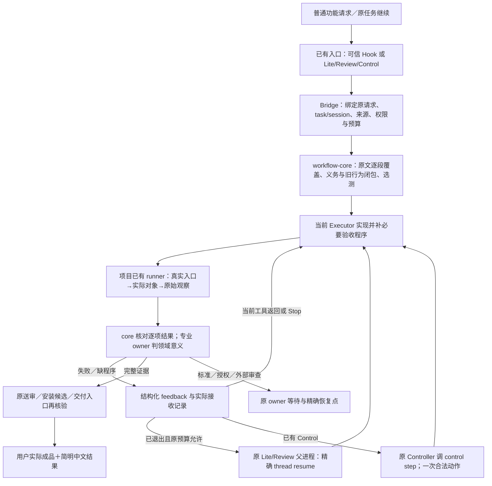

# Delivery Assurance 整体架构：原任务接入、专业验收、同任务返修

**2026-10-22 产品边界已获用户确认：**正常受支持的原生入口尽量零提醒自动接入、受管交付必需真实准入、Hook 缺席不能保证拦聊天已产生的错误完成文字；不开发新 Codex 客户端。不得将“聊天不可绝对拦截”扩大为“允许假成品正式交付”，更不得因一次文档宣称而把实际宿主和七仓自动保障标已实现。本稿是按[10 续研合同](10_ACCEPTED_BOUNDARY_AND_FINAL_ARCHITECTURE_GPT_WORK_PROMPT.md) 收敛的同一方案，冻结与送审状态以CURRENT为准；没有独立Critic结论或实施批准。

推荐一套有明确边界的组合：**在原任务入口建立需求和版本绑定，用一个小型共享库选择与核对证据，由项目既有程序验真实成品，失败回当前执行者，原交付入口独立检查后才报就绪。** 用户正常发功能请求；系统承担查标准、找旧功能影响、补必要检查、解释失败与维护证据的日常劳动。

这次续研已确定算法、接口、接收者、版本迁移和七仓实验合同。拟议代码尚未实现，产品和宿主尚未实测；这与“架构还要让实施者决定”不同。唯一无法靠插件设计消除的产品边界是：任意原生聊天在 Hook 缺席时，插件无法阻止已显示的错误“完成”。01 D1 给出源码证明与替代代价，不能拿交付门成功掩盖这一限制。本研究不自称独立 Critic 通过，也不发执行 Goal。

## 1. 唯一推荐路线与真实运行图

比较结论：只加固七仓脚本会重复身份/选测/反馈逻辑；新建统一编排平台会增加任务权威、账号与运维；**选择小共享接口连接既有实现**。专业运行工具继续是各仓原有 PowerShell、Rust/TypeScript tests、Playwright、Android/Room、科学 validators/finalizer。原生 Hook 是低摩擦接入，受管交付入口是独立准入边界；两者保证不同。

所有跨节点新增调用在03标为设计；图不宣称它们今天已经接通。没有活跃 owner 时不画一条虚构的自动唤醒箭头。没有安装/部署权也不会因为检查通过自动发布。

**成功链：** Lucerna普通刷新请求→绑定真实provider、缺值与旧quota→共享依赖选测→现有runner观察同EXE/PID的刷新→逐项结果与真实接收绑定→原独立原生流程核验→报告真实可用范围。
**坏例返修链：** 固定数只碰巧过第一输入→第二输入失败→feedback携带actual/expected、候选与允许修复范围→同任务消费→修映射→重新选测与观测→原失败保留，新结果闭合。
**旧行为链：** 新卡改provider_runtime→从新旧图反查Codex/OpenAI/Longleaf→旧unknown/stale/动态桶回归；即便手工adapter漏登记，也产生孤儿缺口，不能签“全部保护”。

CAT-TRACE只启发了“共享近似可能一起错，须改变观察路径”的解释方法；其数学结论没有被拿来当DA验证。实际故障、源码和三条完整桌面/Android/科学链见04。

## 2. 五组职责只落在三个既有位置

不是五个服务、36个模块或26个必装 Gate。物理交付只有：Bridge薄适配与已有启动器增量、workflow-core纯函数与格式、项目专业runner/result适配。专业标准仍归原owner，任务状态仍归原工作流。

|职责|删掉它会重现的事故|确定调用／输入|输出与实际接收者|失败与维护|
|---|---|---|---|---|
|K1 入口和身份|旧EXE/旧插件/错分支结果签新任务|已有run_lite_task/run_codex_event、Control preflight、可信Hook → 新prepare_admission；读原请求、源blob、repo/branch/worktree、session、原授权/预算|Admission进入当前prompt与core；完整版本向量进入专业runner；首次受管产品写前完成投影，自举读取/证据草案除外|来源不符拒绝ready；恢复同task并重核。Bridge owner维护host/loaded身份；不编辑领域语义|
|K2 义务与旧保护|原请求被归纳漏项、只跑已知tests、漏旧功能，或500步偷换12步|新compile_obligations/discover_surface/select_checks；原文无丢字分段＋模型逐段投影/反向阅读、机械入口枚举、旧/新依赖闭包、接受基线|ObligationSet/Resolution与具体补验收反馈直接进当前Executor；未知标准回原Planner|空映射/孤儿/动态未知保留缺口，FULL不抹除；共享库owner维护算法，项目owner维护权威/入口提取适配|
|K3 专业运行和观察|Asteria常量量测、SeminarArc错误OCR、科学utility未消费|项目adapter调用原runner正常入口，输入冻结标准/候选/测试数据和效果上限|原始观察＋逐义务GateResult返回调用它的当前模型或Controller；core仅验绑定|产品/程序/采集/标准分流。机械、真实产品、受保护观察三档；按风险用原独立流程，不强制每个小修重审|
|K4 证据与交付准入|不同候选拼绿、Job COMPLETED冒科学成功、ZIP与加载实例不同|新增ingest_result/check_delivery嵌入原送审/安装候选/交付报告出口|Claim的允许/拒绝范围由原delivery owner读取；不给发布权限|缺字段/required UNKNOWN拒绝ready；FAIL不被别项UNKNOWN冲淡；结果可复用须逐依赖有效。core规则与Bridge身份共同维护|
|K5 同任务反馈和报告|FAIL文件无人读、续修洗预算、用户搬运错误|当前工具返回、Stop reason、原launcher有限resume、原Controller control step|Feedback→DELIVERED/ACKED→fresh result RESOLVED；一份中文报告给用户|取消优先，预算沿原task，外部等待不耗轮次。没有持久owner则原任务可恢复，不谎称后台。maintenance board只引用任务|

这些是必要职责而非任意模块分法：K1/K4可复用Bridge既有身份；K2/K4同一个纯函数库；K3不统一重写七仓执行；K5直接放原入口。删去某职责会断开上表具体用户路径；无需独立部署该职责。

## 3. 共享内核与逐跳接口已确定

workflow-core 新 `scripts/delivery_core.py` 提供无副作用函数：
- `partition_request` 保存原文有序UTF-8范围；`compile_obligations`检查全范围映射与必需引用，专业独立角色从原文重建要求；普通任务用当前模型反向阅读，不固定增加一个模型。机械全覆盖不等语义绝无遗漏。
- `compile_obligations(admission, semantic_projection, authorities, surfaces)`：核对原请求/权威引用与不降级条件，形成expected集合；
- `select_checks(obligations, graph_before, graph_after, changes, descriptors, previous_results)`：输出run/reuse/not-applicable/unresolved及理由；
- `validate_result(descriptor, obligation_set, candidate, result, evidence_manifest)`：检查结构/身份/缺证/失效，不计算专业科学分数；
- `evaluate_claim(obligations, valid_results, receipts, requested_claims)`：逐项允许/拒绝，不以退出码或平均分决定。

Bridge 新 `delivery.py` 提供prepare_admission、ingest_result、check_delivery、ack、run_delivery_cycle、report；Hook薄适配调用它。项目adapter负责现有runner→GateResult的语义转换。命令argv、允许写路径、环境和外部效果来自冻结Descriptor及原授权，配置文件不能自行授予权限。

采用明确新wire提案 **da/2**：旧da/1只作诊断读入；新增义务集合、观察与消费绑定是必需条件，不能旧reader忽略后继续签ready。字段、类型、唯一正式消费者、版本握手、相邻PIE引用、shadow、迁移和回退在03 D6/F4已选定。核心不依赖尚未发布的PIE 0.3。

### 没有循环的实际结果消费

runner先写不可变GateResult和原始观察；Bridge ingest_result完成schema/身份/来源解析后，以当前真实调用者身份写Receipt，引用result digest；core再核验claim。ReceiptLocator（受权根、相对路径、receipt_id，不含待生成receipt摘要）可以预先放入result，receipt内容不参与result自身hash；不存在“等自己的PASS才有ack”的循环。反馈的ACK必须来自接收该反馈的执行者；父进程解析结果的Receipt只能证明父进程消费结果，不能替模型签理解。

Hook返回block只算**已请求递送**。必须在后续同session回合/ack看到对应feedback，才能记已送达；不能在Hook退出前假设宿主一定应用了它。Lite使用JSONL确切thread.started及输入digest，仍要显式ack或首个携带feedback-id的真实受管调用；缺或换thread id停止续修。Control现有RuntimeAdapter是抽象类，已选实现为CodexExecRuntimeAdapter，原Controller调用一次性control step，不新增daemon。

**两种阶段，唯一正式消费者。** 所有项目adapter只翻译专业结果；只有Bridge.check_delivery调用同一core evaluator形成DA Claim。Lucerna准备包、Bobbio旧0.2Reader检查、Mica候选材料、SeminarArc基础设施、Asteria静态校验、CUHK活动门、CARE送审包都不是最终USER_READY。03 F2逐仓指定材料接点与原最终owner；前者可在专业review尚待进行时允许送审，后者必须等真实完整结果。受管出口在Hook缺席时仍调用check；正式出口清单也必须验证，任意绕过脚本的操作不声称被插件沙箱拦截。

**有界修复的持有者。** 原父进程持launch lease，短state mutex只做状态读取/版本比较/提交，不持锁等待child。真实开始修复才提交reservation计数；Hook与父进程共享两次/30分钟默认上限并取原合同更小值。取消优先，未知副作用先查原job/安装/票据回执，不以重发resume保证“恰好一次”。不存在存活owner时保留同任务恢复点。03 F3给PID启动身份、部分写入、重复事件与跨OS规则。

## 4. 旧行为、标准和真实成品

旧保护采用已接受行为与当前正式标准；current HEAD只是待验候选，不能自动成为oracle。机械分母是代码可枚举的用户入口/公开API/目标，语义由当前模型对照来源；动态未知消费者要扩大范围并保留缺口。前后图并集处理删除，完整基线diff处理已提交修改。首次/公共入口变更/提取器升级/发布候选做盘点，普通小改只增量；冻结后独立抽旧入口，不让用户维护巨型清单。

标准、产品、runner、collector、原始观察和判定分别绑定。相同用户下的hash/锁只提供漂移检测，不是安全隔离。低风险机械规则不需要每次独立Reviewer；新oracle、安装/账号/科学/视觉风险依项目原独立观察与专业owner。没有真实保护边界不能标PROTECTED_OBSERVATION。坏collector先修collector，不逼正确产品改错；科学负结论在足够机制/规模成立时可以是合法完成结果。

对象至少区分source/build/package/installed/deployed、dataset/model/prediction/GT、报告/实际PDF等。每项claim绑定自己的目标、环境与有效时窗；Mica内存数据不替代高亮PDF，Android模拟器不替物理麦克风，CARE工作镜像不替save/load后archive。运行缺权不改变原目标，已完成的无关部分继续推进。

## 5. 生命周期、持续维护和退出

初次接入主动发现标准、目标、已有checks、缺程序与接收者；标准清楚缺程序由当前Executor补同类检查，good/bad/missing/unchanged校准后准入。标准冲突由原owner裁，不凭“更严格”自动覆盖。第一次纵向链就检查真实机制，公共依赖接通后保护兄弟功能，稳定候选才运行昂贵最终环境。

新增/加固/合并/暂停/退休分别记录owner、范围、依据、期限和替代；暂停required检查不会撤销义务。旧bad和消费者必须迁移，不删除失败例刷绿。中央source-first构建、正式release、安装、实际loaded与每consumer正常入口是不同事实；维护板沿原TODO/DOING/ADAPTING/DONE，不新设DA状态数据库。

回退以已验证Bridge/core/project-adapter组合为单位，停止DA ready但保留项目原验收、有效回归、原任务恢复点；不把da/2强转da/1，不回滚用户数据/作业/生产部署。新层无净收益可以撤掉，原专业检查仍工作。成本与否决预算见06；七仓实验见04 D5。Lucerna高风险凭据启用与Asteria普通方向回归的完整生命周期见03 F5；它们分别说明独立真实观察和轻量同类回归何时需要，不能把所有任务升级为重型验收。

## 6. 已裁决与仍不能伪造的事实

|原缺口|本轮确定的设计|剩余性质|
|---|---|---|
|G1|可信原入口接入＋原交付边界独立核验；拒绝新客户端/daemon；证明Hook缺席无法拦聊天|原生文字限制已获用户接受；不换客户端；各宿主接入与受管交付实测未做|
|G2|入口分母、前后图、孤儿、未知扩围、复用与独立抽样规则确定|有限发现范围，不是全知；提取器和漏检率待实际验证|
|G3|三档独立性、冻结参考/collector校准、四类历史反例路由确定|真实权限/独立观察部署与攻击回放未做|
|G4|当前回合优先、Lite/Review有限精确resume、Control具体adapter/step、七仓原owner接收确定|新增代码未实现；没活跃owner就无自动唤醒，平台限制不可假造|
|G5|七仓成品、正坏旧控制、资源上限、授权和回收完整|真实设备/账号/GPU/部署/手动最终验收未做|
|G6|da/2字段、真实相邻consumer、严格新读/旧诊断、迁移回退确定|需独立Critic审新提案、实现和消费者加载验证；未继承旧批准|

这是一套可被逐跳否决的推荐设计，不是已交付系统。用户已明确接受有限原生文字边界；受管交付质量与同任务返修不能因此减弱。除此之外，实施合同不再要求Codex替Planner选择核心架构。

## 7. 这次最终设计闭合改变了什么

此前已选有界混合路线仍成立，但单凭“有验收、有反馈”不能解决源头漏项与假交付。这次作出五项具体收紧：原文逐段覆盖及反向审要求；七仓低层PASS与最终成品分阶段消费；父子进程不互锁且共享真实修复计数；da/2的定位/摘要、全部字段类型及唯一消费者明确；两种完整验收生命周期和逐任务报告确定。04再用先冻结后追源码的七个反例检验接线，而非重新做一份历史表。

新反证要求保留真实差别：Mica当前构建未加载旧恢复器；SeminarArc实际收到文本的保存正确不等字符注入正确；CARE历史快速checkpoint报告缺HD/HD95不能签完整排名；Bobbio Safe含机器全局更新策略效果，必须在调用前按实际效果授权。源码中已有防护应复用，不把历史事故宣称为当前仍坏。

104–264小时是未经实测的跨仓计划估算，不能以“更可靠”为由一次投入。推荐先完成28–64小时估算的core＋原生/Lite＋Lucerna纵向切片；如果没有减少实际漏检或用户搬运，就退回已有runner补强并保留有效坏例。Review/Control和其余仓的接线已设计清楚，推广仍各自证明。零成品承诺的纯对话不运行产品检查，小文档不启动桌面/GPU，缺授权/取消/外部等待则零自动续修。

本架构可实施性的论据是具体调用链、原始源码、负例与有界退路，不是已经测得产品效果。Windows Desktop、CLI、Remote、GPT Work分别待版本/入口资格验证；任何一个将来获证宿主的结论也不能给其它宿主代签。完整七仓成品仍须以后合法实测。下一位独立Critic可以否决任一箭头；当前没有把额外产品选择交回用户。
