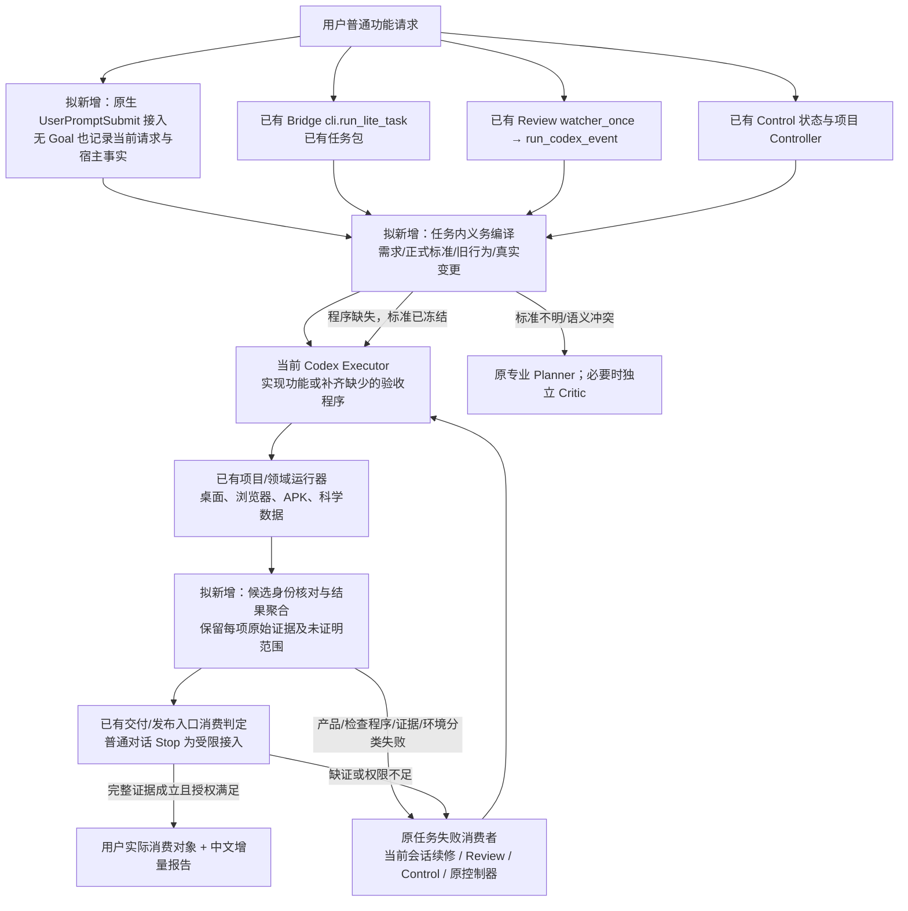

# 整体架构与组件

当前推荐是：让原任务负责继续工作，让项目专业程序负责判断成品，把 Delivery Assurance 收缩为连接两者的一组共享函数。用户照常提出功能要求；系统自动准备本轮验收义务，调用已有检查，补齐确实缺少的程序，沿原任务返修，最后从真实使用对象得出可声明的结果。

这是候选 v0.1。下图中的“拟新增”均未实现；源码已存在也不代表本轮实际运行。原生 Hook 全宿主可用性、未登记旧能力的保护下限仍待闭合。

## 1. 总图：只保留一个执行权威

图中共五组新增或重构职责，分别是入口绑定、义务编译、专业验收适配、结果判定和原任务反馈。它们不是五个常驻服务。持久任务状态继续属于 Lite 文件、Review CURRENT、Control CURRENT 或项目控制器；本轮结果是任务附属产物，不能再发明并行状态机。

## 2. 正向链与坏候选链

以 Lucerna 增加真实用量显示为例。用户请求由拟新增原生接入保存；workflow-core 的拟新增 `prepare_delivery_obligations` 从请求、正式产品要求、现有 provider 和测试读取证据。它把“真实来源、单位、时间、不能伪造未知余额”与共享配额旧行为一起交给当前 Codex。已有 Rust 测试和 `development-acceptance.ps1` 按授权运行。新增的项目结果适配函数读取实际结果，公共判定核对源码、EXE、PID和截图属于同一个候选。日常任务只跑对应范围；正式交付再进入既有独立 release 验收。用户得到功能状态和检查变化说明。

坏候选把所有余额硬编码为 680。检查必须用两组不同原始输入、独立期望值和未知额度上限样本。结果携带实际值、期望值、原始输入定位、候选身份以及责任分类。当前会话内，拟新增 Stop adapter 返回有界续修理由，当前 Codex 读取完整失败文件，修 provider 后重跑受影响旧配额。Review 则由已有 `watcher_once` 消费新的合法状态事件，`executor_prompt` 读取 REVIEW；Control 则按现有 findings 路由。不能把三者预算相加，也不能由 Stop 再启动 Review 或 Slurm。

这只是设计推演。本轮没有使用真实账号，也没有运行 EXE；七仓的具体程序、历史失败和可证伪条件将在 04 文件逐项核实。

## 3. 组件边界与最小改动候选

| 组件 | 当前事故/缺口 | 真实拥有者与候选改动位置 | 输入 → 输出 → 消费者 |
|---|---|---|---|
| C1 入口与身份绑定 | 普通对话无任务包；旧 EXE/旧扩展冒充本轮 | Bridge：`readiness.py`、`cli.run_lite_task`、`reviewed_runner.run_codex_event`；原生 hooks adapter 拟新增 | 平台 session/turn/cwd + 当前任务/分支 + 用户请求 → 任务绑定 → C2及原执行者 |
| C2 任务义务编译 | Skill 没调用、adapter漏旧功能、标准有而程序无 | AI_Skills workflow-core 源码下拟新增纯函数；项目正式标准仍由项目拥有 | 请求+基线+变更+领域标准+现有检查 → 义务/选测/缺口工作项 → 当前 Executor及C3 |
| C3 专业运行与校准 | fixture替实际产品；假保存；损失没进训练 | 七仓原生脚本、专业插件；仅补必要结果适配与缺失检查 | 冻结义务+候选+授权环境 → 原始观察及逐项结果 → C4 |
| C4 证据与声明判定 | 写PASS却没运行；截图过期；阈值跟着产品改 | Bridge持有身份核对；workflow-core聚合语义；领域负责人解释专业结果 | 检查结果+独立标准+候选运行对象 → 可声明范围/失败 → C5及既有交付入口 |
| C5 原任务反馈和读者报告 | Reviewer反馈没人收到；无限返修；用户看日志 | Bridge原有入口及项目控制器，拟新增结果消费调用；不另建watcher | C4完整失败→原预算内修复/合法等待/必要用户动作；最终中文变化报告→用户 |

C2不能根据关键词替代领域判断。未知旧功能不能靠空数组得到“无需检查”；应从基线正式入口、既有测试、被调用公共接口、已接受行为与变更传播核对覆盖，仍不确定则扩大本仓便宜回归并保留覆盖未知。扩大不授权真机、GPU或付费。

C3缺少程序和缺少标准必须分开。标准明确时，任务内工作项包含原条款、输入、好/坏/缺证样本、写入位置与结果格式；当前 Codex完成实现。标准冲突时不让执行者修改成功定义以得到通过。

C4不是万能评分器。它只能证明结果身份、义务满足和证据范围；视觉质量、科学意义与专业正确性仍需对应程序和独立审阅。执行者可写输出文件，所以文件哈希与PASS字段本身不是真实性证明；高风险发布消费方必须独立运行或直接观察。

C5的反馈载荷不增权限。用户中断后只记录；外部审查未返回新决定时保持原状态等待；失去进程且无既有恢复者时明确报告不能自动继续。后台续跑能力不能由一份待办文件产生。

## 4. 与既有方案的具体取舍

复用：Lite/Review/Control/Persistent Run 的任务、预算、角色和恢复；七仓成熟验收程序；领域插件的专业标准；维护看板的中央完成与消费者适配区别。

删除或拒绝新增：中央万能评分器、独立跨仓任务数据库、第二套Slurm调度、以36职责对应36模块的结构、为每个历史事故新增Gate、通过回执数量证明完成、所有小任务都走Control。

重构：将旧DA接口中必要字段作为兼容输入候选，先按真实消费者证明用途，再决定保留；不因 `da/1` 冻结过就强迫生产入口接受整套设计。若后续确认已有消费者，迁移需双读、等价对照和明确切换；当前尚无生产消费证据。

新增必须证明的价值：无任务包的原生接入；发现缺失验收程序并交给当前执行者；根据实际变化保护旧能力；真实消费对象绑定；逐项结果被原任务及交付入口读取。任一新增没有接收者即为未闭合，不算架构完成。

## 5. 目前可否决该架构的条件

- G1：原生 Hook 未信任/失效/宿主不支持时，无法保证普通聊天的完成表述被拦截；独立交付入口也可能不存在。
- G2：初次基线无法可靠发现全部隐含旧能力。必须定义可审查的保护下限和未知升级，不能承诺“所有旧功能均发现”。
- G3：同用户执行者可写检查器和结果，高风险独立观察及冻结标准必须实际由不同权限/角色消费；仅哈希不足。
- G4：当前原任务没有活执行者或恢复权威时，不得承诺无人转发的自动返修。
- G5：最终真实设备、安装、账号和科学结果未获权验证，不得以本轮只读分析代签。

后续文件必须给这些条件的具体实现选择、仍需验证的事实和停止声明；它们不能被延期到实现者临场决定。
