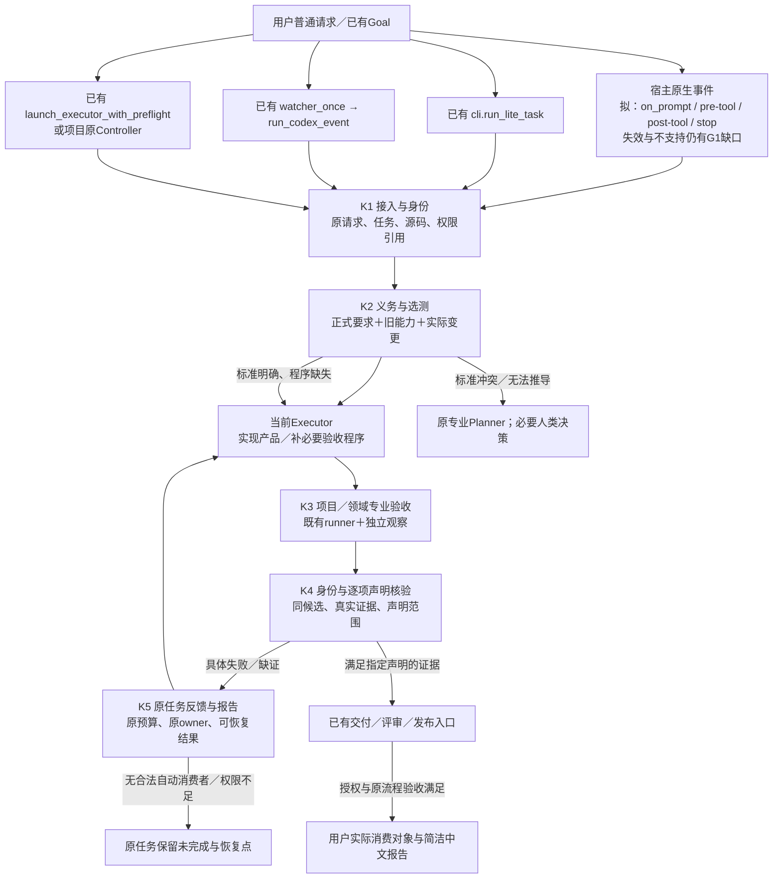

# 整体架构与组件：让原任务真正消费验收结果

推荐保留五组职责，物理上实现为**既有执行入口中的少量调用、一个共享纯函数库，以及项目原有专业检查的适配**。任务仍归原执行者；验收标准仍归专业owner；Delivery Assurance不获得第二份调度权。它的价值应体现在用户少提醒、坏候选更早暴露、旧功能受保护和成品身份清楚，而不是多出一套状态文件。

这是源代码调查后修订的架构候选，**设计尚有核心阻塞，不能交实施Goal**。初稿先写入GitHub后，再由七仓反证修订：新增了早期工具入口检查、有效开发分支区分、观察器校准、科学负结果分流；没有把旧v0.5作为正确前提。真实函数与逐问题合同见03，七仓链见04。

## 1. 总图与运行直觉

这张图不意味着每个箭头今天已经接好。实线表示建议的数据路径；节点中的“已有”只说明现存源码，跨节点新增调用在03明确标为待实现。尤其原生Hook失效路径、外部Reviewer回传、项目文档里的Controller是否存活都必须真实验证。

一条正向任务是：Lucerna修刷新→接入保存用户原义→把真实刷新和旧quota状态作为义务→选择已有Rust和原生runner→真实EXE同PID操作产生后置状态→逐项判定→原release流程消费→报告哪些已可用。一条坏链是：共享状态把unknown写成0→旧quota控制例失败→原执行者收到actual/expected和来源→修映射→重跑影响闭包→最终安装检查；不是让用户拿截图再来指出。

CAT-TRACE的方法启发是“先找到同一种近似相互印证仍会一起错的反例，再改变计算路径”。本研究对应的是：产品自报数值与验收器读取同一自报值可以一起错；所以要独立原始观察。参见[零槽位导读](https://github.com/YuukiAS/CAT-TRACE/blob/0d829fb17c458a076a15ec51893e917960107c21/docs/implementation/architecture/CAT_TRACE_ZERO_SLOT_ARCHITECTURE_GUIDE_20261014.md#L63)。数学方法的准确性与数值边界属于CAT-TRACE，本研究不据此宣布它已验证。

## 2. K1 接入、来源与执行身份

**事故与必要性。** Lucerna历史旧EXE/PID混用（L22），Mica主线/ZIP/实际加载版本错位（M04/M45），Bobbio旧里程碑代签（B14/B26）。现有Bridge能绑定受管执行源码，但不会替一个无任务包的普通对话建立完整交付义务；一个repo HEAD不能代表用户运行的程序。

**owner与入口。** Bridge拥有启动、repo/worktree、session、Host权限及加载身份。已有[readiness.py](https://github.com/YuukiAS/GPT_Codex_AI_Bridge_Kit/blob/ba9013b9fbbd242e51b09f9d09291f417df17652/ai_bridge_kit/readiness.py)、[cli.run_lite_task](https://github.com/YuukiAS/GPT_Codex_AI_Bridge_Kit/blob/ba9013b9fbbd242e51b09f9d09291f417df17652/ai_bridge_kit/cli.py#L657)、Review launcher、Control launcher分别接入；新原生delivery_hooks.py属于Bridge，尚无生产实现。不新建host进程、App reader或线程。

**输入→输出→接收方。** 原始用户请求、现有任务、原owner、mandatory source blobs、实际执行上下文和当前授权引用→admission.json→K2和现有prompt。例如Bobbio 0.3请求必须绑定develop a64edfd及其CURRENT_MILESTONE，不能读main 0.2后假设接受。请求改变保存revision，不能悄悄改原目标。

**分支与三类控制。** 正常来源/任务一致可继续；错分支/旧载荷/工作树冲突拒绝ready；报告文字更新且runtime不变应保持旧二进制证据有效。无任务包用原生轻量记录；无Hook能力只能指导或使用显式受管入口，影响用户体验必须说明。缺账号不是重新初始化真实账号的理由。

**恢复与生命周期。** 现有任务恢复时重核来源和效果权限；不新task洗状态。安装、更新、信任重置、卸载逐宿主处理，旧payload按兼容矩阵保留；权限不跨不可证明的session重用。Bridge源码与正式distribution仍分owner。

**最小改动/成本/否决。** 在三个launcher加入prepare/check调用；原生五类事件适配一次；每次使用已有来源缓存但校验实际blob。测启动延迟、用户信任操作、是否误阻小修。任何supported入口可绕过且仍报告受保障，G1不关闭；Windows fcntl/锁兼容必须独立测试，不能从Unix Bridge外推。

## 3. K2 义务、旧行为发现与选测

**事故。** Mica关闭主功能得到安全（M14），CARE 500步变12步（C23），Lucerna共享状态旧能力被吞（L17/LX12），Asteria无基准diff漏已提交修改（A42）。已有测试目录只能告诉我们“有什么测试”，不能推出“用户这次需要什么”。

**owner与真实落点。** AI_Skills_Collection canonical `skills/core/codex-system/codex-workflow-protocol/` 持有通用准备/选测/聚合规则；拟在其scripts加入delivery_obligations.py的prepare_delivery_obligations/select_checks。当前SKILL指导已有，拟新增纯函数不存在。Bridge只调用已安装/启用的精确版本；项目owner提供专业合同和依赖适配。中央不得复制领域阈值。

**数据与算法。** K1 admission＋原请求＋正式标准＋接受基线＋全变化集＋实际入口清单→obligations/resolution/work_items→当前Executor和K3。按原请求建立expected set后才匹配gates；反向消费者闭包决定范围；依赖未知先修映射，不能以全跑已知测试替代未知旧能力。六维类别判据与完整算法见03 E4。

**三类控制。** 普通README文字修正只检查文档；shared provider改动选兄弟quota；空adapter/漏公共入口必须coverage_unknown，不能NONE。should_not_change来自既有接受来源，不是本次临时自造“旧功能”。

**失败/恢复。** 标准已有、runner缺失产生具体BUILD_VALIDATOR给现Executor；缺标准/冲突返回原专业Planner；缺环境/权限留独立阻塞并继续无关工作。模型语义提取仍会漏要求，不能被JSON schema校验神化；原请求逐条对照与独立盲抽样是G2最低证据，不是完备定理。

**生命周期/成本/否决。** 每次新入口/删测试/改共享generator自动标记映射重审；case合并不删除保护。纯函数不持有第二CURRENT；source-first生成插件，消费者版本不符阻止ready。测分析时长、漏选与过度FULL；若对少量任务没有净收益，退回项目本地选择，保留有用回归。

## 4. K3 专业验收程序、运行器与观察者

**事故。** SeminarArc只有点击不能证明保存，OCR选择器误读造成假阴性S11；Bobbio假Zotero性能代替真实批注；Asteria crossing常零；CARE参数有名却没有因果消费。中央通用脚本无法知道这些专业语义。

**owner与复用。** 七仓专业owner拥有标准、原程序和回归；已有Lucerna PowerShell、Bobbio隔离runner、Mica acceptance CLI、SeminarArc黑盒、Asteria browser tests、CUHK parent gate、CARE finalizer/validators直接复用。新增只有缺失检查和结果适配。领域plugin提供正式标准/能力，不夺项目执行权。

**触发/数据/消费。** K2选出义务和当前效果权限→现Executor/Controller执行白名单argv→真实runner原输出与原始观察→项目adapt_result→K4。补程序工作项具有原条款、三类控制、明确写路径、命令与回报位置，见03 E5–E7。命令是数据不能自动授予shell或账号权限。

**判断与反例。** SeminarArc正确OCR控件非空且重启保留为good；旧错误定位要产生observer fault，不能叫product fail；录音已接受路径不得为修照片被破坏。新validator要通过good/bad/missing/unchanged；坏例必须经同生产验证路径。高风险更需独立冻结参考和实际观察，源hash不是可信签名。

**失败与维护。** product修产品，observer修采集器并重采，oracle修标准走专业owner；科学充分负结果不修成正面。新增/更新/暂停/退休按03 E8；停检查不取消原义务，合并迁移全部历史case。授权环境不可达不偷偷换成低等级；Mica已明确允许target-class的范围不推广到Android真机。

**成本与否决。** 复用一次运行满足多个义务，cheap-first，稳定候选再真设备/昂贵检查。只增加回执而不能拒绝真实坏实现则取消该adapter设计；Asteria独立geometry与CARE训练恢复等价未验证前保留G3，不说全部26类已实现。

## 5. K4 证据身份、逐项结论与交付准入

**事故。** Lucerna不同PID截图，Mica source/build/loaded不一致，CUHK Web/API/campaign混版，CARE Slurm COMPLETED没有预测；Asteria“指标0”只是默认值。需要把“检查程序退出”和“目标被证明”分开。

**owner与接点。** Bridge复用身份/semantic snapshot/来源校验；workflow-core拟validate_delivery_claim做纯集合判断；专业owner解释结果。既有交付边界读取：Lite父进程只准自己的ready通知，Review原发布就绪检查、Control transition predicate、项目finalizer的送审边界。原生聊天文本由宿主，不能声称K4掌握不存在的发布闸门。

**输入输出。** obligation set＋candidate vector＋原始run/observer证据＋冻结standard＋独立审查状态→每项PASS/FAIL/UNKNOWN及可声明层级→K5和既有delivery owner。vector不是单commit，包含每仓源码、构建/安装/部署、数据/model、observer和环境。只控制结果身份，不做科学正确性万能评分。

**规则与三类控制。** 同候选真实观测匹配才允许对应claim；旧截图/未跑job/缺ratio/缺result拒绝；只改审计文字不让无关运行无限失效。一个义务FAIL和另一个UNKNOWN可同时留存，不平均。不用GitHub绿色check直接证明产品；required job skipped不算实跑。

**恢复与生命周期。** 错身份先重绑/采集，不为了过测试改产品。标准/observer变化沿依赖失效；报告可以重建；原失败append保留。对象版本升级逐consumer验证，退出保留审计链。禁止把same-user可重写文件当不可篡改证据。

**成本与否决。** 缓存semantic digest避免receipt hash循环；大文件用已有构建manifest但审来源，不能无限哈希医学数据。核心否决是不同候选材料能拼绿、required集合可清空或同源造假仍被视独立。G3必须通过实际攻击试点。

## 6. K5 同任务反馈、等待、维护与读者报告

**事故。** Reviewer报告没人收、Mica连续新Goal重置，CARE只留NEEDS_MONITOR便退出，Lucerna工具修理吞掉开发，用户被迫搬运错误。生成FAIL文件不等于形成下一步执行。

**owner与真实消费。** 活跃Codex直接读命令失败；Review watcher_once读取当前合法REVISE→run_codex_event→executor_prompt；Control route_current_findings返回路由→**已有**Controller实际launch；CARE原Controller消费finalizer；CUHK Parent消费当前campaign反馈。这些接线有的待新增、有的运行存活未证，G4不能藏起来。

**消息。** K4工作项带task/candidate/actual/expected/source/evidence/classification/修复范围/失效项；原ownerack后执行并产生fresh run关闭。报告从实际清单派生新增、加固、复用、未跑、关闭及未证明范围；不给用户一屏内部状态码。无需新增validator也要说明为什么。

**三类控制与预算。** good新鲜反馈只消费一次；bad旧review target或中断后不得再开进程；另一独立任务保持原进度。Lite一次子进程、Hook受限一次续修、Review事件attempt/轮次、Lucerna独立最多三轮、CARE合同预算互不相加。等待不消耗修复；重复同因无新证据先根因审计，不无限换命令。

**生命周期/恢复。** 断线由原持久owner恢复；没有owner则诚实给同任务恢复位置，不能许诺无人值守。外部GPT正常等待不写BLOCKED终态；两小时只是最低宽限，无新证据不重试旧决定。中央维护看板引用现有task，不产生第二任务状态。

**成本/否决。** 普通报告确定性模板即可，既有Notifier可选表达适配而不改变事实；不额外造控制台常驻服务。若修复消息未到执行者、用户仍需反复转述、同一错误重复占预算，试点失败，先修消费链或取消新增层。

## 7. 删除、复用、重构、新增及未闭合边界

|处理|决定与理由|
|---|---|
|删除/拒绝|第二任务数据库、第二Slurm调度、万能评分器、36个服务、每历史条目一个Gate、第四种Bridge自主workflow、常驻app-server reader、强制所有小改全量review|
|复用|Bridge既有身份/预算/状态/Host/Persistent/Notifier；七仓runner；项目Controller；领域标准；AI Skills发布与maintenance board|
|重构|旧da/1字段仅按消费需要迁移；26能力族用于归类而非强制模块。旧冻结接口不是本轮正确性依据；如果发现真实consumer才做双读迁移，不猜它们不存在|
|新增候选|原生接入适配；通用义务/选测/claim纯函数；项目最小result adapter与确实缺失validator；在已有交付边界加真实调用|

G1普通原生失效路径、G2未知旧行为、G3独立观察、G4活跃反馈消费者、G5真实最终环境分别保留。G1可能改变推荐路线：如managed hooks或平台接口不能达到用户原承诺，需要独立Critic要求架构REVISE或由用户明确接受额外受管入口摩擦，不能把后者悄悄算原目标已完成。G2/G3必须冻结可验证保护边界，不能承诺绝对发现所有未知缺陷。所有未实现接点有06分包位置；任何关键设计未闭合都阻止发执行Goal。
