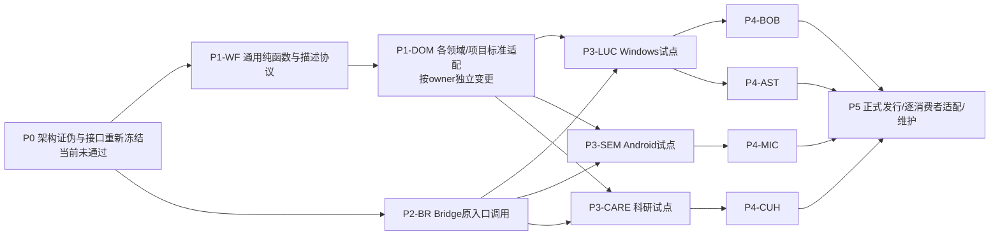

# 分阶段实施、试点、维护与退出合同

本文件提供待独立审查的实施设计，不是Codex Goal、开工指令或资源授权。**当前P0未通过，后续包均不可据此开工。** 不能让Executor在写代码时决定普通入口是否可支持、谁能独立签字、反馈由谁接收、是否兼容旧da/1；这些会改变体系成立条件，必须先由Planner/独立Critic关闭。

推荐结构仍是02的五组职责；物理实现分属Bridge、workflow-core、领域/项目源和既有维护发行体系。各包只在自己的source authority内改动。各仓基线用01/04/05的固定SHA，正式开工时先比较漂移并重新绑定，不擅自切换用户当前分支。

## 1. 依赖与开工判据

图中先后是风险递进建议，不是跨仓串行锁。P3三仓各自证据独立；P4不拿前仓PASS代签。比如Bobbio只需共享接口和Windows接点证据，不必等CARE GPU任务结束；任何外部GPT等待不阻塞无关合法包。七仓采用率只按逐consumer结果计，不能用中央实现完成率代替。

所有包遵循：
1. Planner冻结目标、真实最终对象、不能降低的数据/规模/方法、三类控制与缺证控制、源版本、写范围、effects、原owner/预算、退出路径。
2. 独立Critic按当前准确review target审查；旧意见、旧commit及本研究内部反例不是新批准。
3. 用户仅对真实HUMAN_ONLY边界授权；当前用户未授予的设备、账号、GPU、后台进程、部署和发布在前置阶段提出，不能投入大量工作后才暴露。
4. 实施沿当前选定分支。Reviewed Mode仅在该包明确采用且允许时使用精确reviewed/<task_key>；不因跨仓工程大擅自新分支、PR或强推。普通提交与发布仍按原Machine Policy分开。
5. 每包以一条正常用户链验收：普通请求→选测→真实执行→故意坏候选被挡→反馈由原执行者消费→修复→旧能力不变→最终对象/中文报告。不能只测试新helper或JSON解析。

## 2. P0：先验证会改变架构的条件

**用户能力。** 得到诚实的支持范围和最低摩擦入口；不会先安装一套“全自动”系统再发现普通聊天根本没接入。

**来源与边界。** 本研究文档、Bridge release ba9013b9及dev 7f43e146、AI Skills f1de8e85、实际安装宿主版本与信任配置。当前只读研究已完成源码论证；以下真实宿主实验仍需精确试点授权。P0不训练、不部署、不读私有账号，不安装常驻服务、不造控制器。

|冻结决定|具体可否决验证|谁消费/失败后动作|当前情况|
|---|---|---|---|
|支持入口与强制程度G1|每个宣称支持的Desktop/CLI/Remote版本，从无任务包普通请求开始；记录prompt→pre/post→Stop；禁用、失信任、超时、错误输出、工具覆盖缺口、Interrupt、重复event、错session负例|宿主与Bridge owner；不能挡原生完成就不得标ENFORCED，重新选入口/承诺|无当前实机证据；GPT Work无同等接口证据|
|来源/旧行为边界G2|独立选择一个未准备功能与一个未登记旧行为，比较公共入口/依赖发现与人工源码审计；测试删除/committed/staged/untracked变更|项目owner补映射与算法；若只靠人工列完整清单，不满足低摩擦承诺|只有设计与源码反例|
|观察独立性G3|候选协同改结果/expected/hash、常量指标、旧图/错误PID、缺原始观察；正确good仍应通过；参考变更不能自动获准|原验收owner隔离参考或独立观察；没有工具能力则该claim禁止|same-user隔离及跨域能力未证|
|实际接收者G4|WID从失败runner实际送到当前Executor/Review watcher/既有Controller，记录ack、下一合法调用和修复新run；进程结束、断线、中断、stale review分别验证|该入口原owner；无接收方保留原任务恢复点，不新后台|文档/代码接点可定位，端到端未证|
|版本合同G6|旧da/1 required fields与新语义逐项差异，枚举真实consumer；用相容/不相容材料证明拒绝、双读或迁移|workflow-core语义owner＋Bridge身份owner＋独立Critic冻结唯一规范|本稿schema_version:1只是说明，非da/1正式wire|
|成本与权限边界|无产品变更/小功能/共享变更三档实测额外调用、等待、用户动作；无授权effect必须在动作前被原host拒绝|原owner确认预算与任务模式；不要把安全拒绝算产品fail|无本轮量测|

P0的可接受输出不是“都支持”：可以证明某入口不支持，但若它属于原始核心用户承诺，则总体仍REVISE，不能用删除该入口换PROCEED。替代受管入口有现实价值，却需要用户明确接受新增操作与覆盖差异。

旧[da/1冻结](../../16_THREE_RUN_SYNTHESIS_AND_DELIVERY_ASSURANCE_20261015/DELIVERY_ASSURANCE_PUBLIC_DA1_INTERFACE_FREEZE_V1_20261020.md)第22行要求：必填字段、owner、decision/identity/authority/claim/routing等语义变化回Planner/Critic。本研究建议把UNKNOWN impact先修映射、仅在真正消费者处准入，并重界定Hook/Lite预算和轻量原生上下文，不能声称它们天然保持旧freeze。**决定：不复用旧PROCEED，不自行授予新wire版本；冻结失败则P1/P2不得进入执行。** 能兼容的诊断字段保持可忽略，不兼容required/语义必须拒绝；在发现全部真实consumer之前不得宣布迁移完成。

## 3. P1-WF：公共义务、选测与声明的纯函数

**用户变化。** 同一请求会自动得到应保护的旧行为和必要验收；缺程序会形成给当前执行者的工作项，缺标准不会被模型随手编造。

**source authority。** AI_Skills_Collection@f1de8e85957d32a50f4458349f450ec65add13bb，canonical `skills/core/codex-system/codex-workflow-protocol/`。新增候选 `scripts/delivery_obligations.py`、邻近schema/controls；SKILL只描述入口与解释，不能充当唯一执行触发。现有目录中尚无这些生产文件。保持现有任务协议、升级规则和专业阈值。

**冻结后的函数合同（均待实现）。**
- `prepare_delivery_obligations(admission, request_sources, accepted_contracts, source_inventory)` → obligations + scope_questions。原请求/标准引用不可空；语义缺口与设备权限分开；同scope revision的必需保护不随候选删除。
- `select_checks(obligations, full_change_set, dependency_graph, descriptors, reusable_runs)` → resolution + work_items。包含真实变化来源、反向消费者闭包、run/reuse/unknown理由；缺映射不返回NONE。
- `validate_delivery_claim(obligations, resolution, observations, identity_validation)` → claim_by_target + findings。只做集合、完整性、来源和声明准入，领域分数由原owner解释。
- `render_delivery_report(claims, runs, changes, pending)` → 简洁中文摘要＋可展开明细。每次列新增/加固/复用/实际运行/合法未跑/修改或关闭/未证；无额外模型调用是默认路线。

Bridge把其身份校验结果作为明确输入，不让workflow-core重做Host权限。项目runner由原执行者调用，纯函数不可自行启动外部命令、修改产品或批准效果。

**冻结字段及接收者。** 03 E3–E7是内容示例；正式schema必须定义required/nullable/enum/错误分流：
|记录|不可省略的语义|直接读者|
|---|---|---|
|admission|task/session与缺失原因、repo/worktree、owner、原请求、源码版本、效果权限引用、scope revision|prepare与原prompt|
|obligation|唯一ID、标准来源/版本、目标、required/不适用依据、旧保护、证据方式、不能替代条件|selector/validator/原Executor|
|resolution|每obligation的run/reuse/blocked、理由、descriptor/runner身份、输入失效集、环境/effect|原Executor/Controller|
|observation|task/candidate向量、obligation、原native结果、实际runner/observer与环境、原始观察locator、PASS/FAIL/UNKNOWN及因果分类|claim evaluator|
|work item|WID、原来源、actual/expected、原证据、归因、写范围、原owner、允许动作、被接收状态|原Executor/watcher/Controller|
|claim/report|所请求层级、逐required缺项、实际可证明范围、回退/恢复定位；派生数据不可回写工作流状态|原交付/用户报告入口|

**可否决验收。** good当前完整结果正确允许对应claim；bad empty adapter/删除required/混候选/旧结果/false PASS/未运行job全部拒绝；missing独立原始观察→UNKNOWN；README改字不启动设备/GPU，旧产品检查保持可复用。测试必须调用和正式入口相同的函数与schema，不额外写一个仅供fixtures使用的判定器。

**恢复/成本/退出。** 选错scope由selector owner修，领域冲突回原专业owner。以相同输入输出确定性结果，不持任务数据库；读取缓存以source blob为键。回滚公共库和对应adapter的已验证兼容组合，保持原项目runner直接可用。净收益不成立时可退回A，仅保留有用的原生检查；不可删旧bad。

## 4. P1-DOM：专业标准分包，不建通用评分器

这是七个owner各自的标准/适配变更边界，不是一个可并行启动七仓的Goal。包D-LUC/D-BOB/D-MIC/D-SEM/D-AST/D-CUH/D-CARE分别位于04所列现行项目合同及专业runner；没有生产统一descriptor时，由各项目先表达最小实例，再决定是否有多个消费者值得提升为领域plugin能力。

AI Skills `PLUGIN_CAPABILITY_GATE_POLICY.md`控制成熟能力被正式消费；canonical专业plugin源码如需扩展，应由其原Maintainer单独冻结路径与版本，不能把项目阈值搬进workflow-core。当前未决定新增某个领域plugin，因此没有伪造未知源码目录或一揽子插件安装任务。

每个D包的产品是“已批准标准能被正常入口找到并调用”：03 E5给格式，包含标准来源、目标/证据方式、runner注册argv、observer能力、effects、good/bad/missing/unchanged和生命周期。标准已定无程序才BUILD_VALIDATOR；只多一个案例优先补回归，不新建类别。owner逐项准入后交该仓P3/P4接线；单独descriptor通过不算接入完成。

D包变更标准或oracle必须使相应旧结果失效；产品与验收程序可同轮修，但独立参考不随候选自动变更。合并/退休迁移bad与所有消费者；required检查被暂停时目标仍未证。成本归该专业owner，通用层不复制媒体、医学或几何知识。

## 5. P2-BR：在Bridge现有入口真正调用

**用户变化。** 不再靠用户提醒“记得验收”；失败结果能进当前任务prompt/既有控制器。普通原生支持程度严格来自P0。

**基线/修改。** release ba9013b9fbbd242e51b09f9d09291f417df17652与产品开发7f43e146eed50d290ef9cc6ab912d106f754042c并存。选定真实开工分支须遵守项目当前authority，不直接把dev发布。候选改动：
- `cli.py::run_lite_task/_lite_task_prompt`：preflight后准备义务；把工作项输入同一次子进程；返回后校验claim才准ready通知。
- `reviewed_runner.py::executor_prompt/run_codex_event/watcher_once`：消费本任务新鲜工作项；由合法Reviewer决定REVISE，保留event attempt/round预算。
- `agent_flow.py::launch_executor_with_preflight/route_current_findings/apply_transition`：转换为现有typed finding，原Controller的所选adapter实际消费并回传ack；不另写控制器。
- 拟 `delivery_hooks.py`：对P0已证明支持的prompt/pre/post/stop/interrupt事件做薄适配，读取同一库，处理幂等与取消。
- 如增加 `ai-bridge delivery report`，它只读取当前任务引用的材料，输出简明状态与变化；不可扫描“最新绿灯”或成为第二监控服务。

不改变Host权限、scheduler、Persistent Run寿命职责、原工作流状态枚举，不恢复app-server reader/事件总线。Windows现有fcntl/锁兼容必须专门验证；WSL通过不代表Windows Native通过。

**真实验证。** 无准备任务包请求从正常入口产生义务；只装Skill却未调用仍由确定性接点发现required缺失；坏claim返回WID并由原执行者读到、修复、同task重跑。错task/session/candidate、旧review、duplicate event、用户Interrupt、拒绝effect必须不再续修。Lite退出后只报告未完成与恢复点，不偷偷第二次codex exec；Review不会把thread_id=None包装成原App会话。

**恢复/预算/回退。** 各entry沿自己的budget，Stop续修与Review/Control轮次不累加新预算。外部GPT至少两小时正常等待且有健康状态就继续等，不消耗repair attempt；没有合法connector则明确G4。回退移除新增调用并恢复原launcher行为，保留原任务文件、未完成结果和专业检查；不能伪装为交付PASS。

## 6. P3三个不同产物试点

### P3-LUC：真实Windows资源刷新与旧额度

基线Lucerna@79dd2875d3da33c6a6d80e5e35bea812b84c1ceb。复用 `scripts/development-acceptance.ps1`、`scripts/acceptance-preflight.ps1`、Rust provider/quota/runtime；候选新增项目adapter与provider-state检查，接点是现有admission与同run绑定之后。不得更改独立原生Producer/Reviewer角色边界、真实配置、凭据、启动项与安装偏好；本轮未启动其子任务。

冻结普通请求“刷新真实状态，旧Codex/OpenAI/Longleaf保护”，最终对象为明确EXE/hash/PID与授权桌面/账户。数据映射可先用原始可信schema控制例；真实刷新必须有实际provider观察和UI后置状态。good两个不同动态输入与真实刷新；bad恒值/unknown→0/旧EXE截图；missing上限/账号数据；unchanged Codex桶、stale/unavailable与共享刷新。Mathpix680仅额外对抗样例，不宣称当前已有Mathpix功能。

WID stdout→当前Executor，产品映射缺陷修Rust/前端，PID缺陷修采集器；原独立Reviewer收同候选新证据。最多轮次沿原合同，不能把工具修理当产品进展。最终报告分源码、安装、账号、原生完整UI层级。回退DA接点保留全部隔离与原验收；任何安装/升级回退先确认恢复备份和用户授权。核心否决：用户仍要自己发现假刷新，或过关程序测了别的EXE。

### P3-SEM：Android保存、强停与重启

基线SeminarArc@5652fe17ce60625f3ff7c758fcc0183f920189de。修改候选 `scripts/run-blackbox-acceptance.ps1`结果适配、`scripts/verify-gpt-work-acceptance.ps1`交付消费；复用Run-B02/B04/B07和现有Room/migration。无证据不要改EndSeminarUseCase或录音service本身。

冻结指定APK、serial、模拟/物理范围和合成/授权素材。普通请求“编辑笔记后重开仍在”→创建编辑→强停→重启查询→独立内容读回。bad UI假保存；missing动态probe；collector bad错误OCR选择器。unchanged录音、照片、搜索/导出和迁移消费者。SkipDynamicProbe必须保持NOT_EVALUATED。照片通过不声明外部录音导入，物理麦克风/OEM不由模拟器代签。

原Executor读完整失败；observer误读归runner owner，正确产品不改坏；产品缺陷修storage/transaction，再跑影响闭包。首次实际安装/清数据/真机动作需精确授权，不能在用户设备盲试。回退接点保留持久化与原生验收；数据迁移另有可恢复备份与批准。否决：坏保存仍绿、错误OCR逼产品改错、开发工具变更强制用户安装新alpha。

### P3-CARE：真实机制、足够运行、负结果与终态

基线CARE_Challenge@75a40e454de43b64e59a0b0b438ff57ef2bb8345。当前main科学合同优先；历史Route B/Batch7仅控制来源，不恢复旧任务。候选改 `scripts/ops/care_milestone_finalizer.py`结果adapter、既有科学validator及原Controller接收点；`validate_care_ase_freeze_reload.py`只在一个当前明确任务需要恢复训练等价时补适用对照。不能修改科学模型/指标门槛来配合DA，不能用CARE_ASE入口替另一路线。

试点先由科学Planner选择一项已经合法冻结的bounded train/eval，指定formal entry/model/pretrained/data split/scale/最低时间与评估总体/资源/终态输出。**本稿不替它选择新科学路线或给GPU数量**。在这些科学输入没有确定之前，该包不能形成执行Goal。这是权限与科学authority阻塞，非留给实现者自由发挥。

good真实forward/loss/backward/step与足够运行、独立预测/GT/aggregation；bad12步冒充500、utility不消费、所有intervention复制metrics、丢RNG/sampler后恢复；missingcheckpoint/原输出；unchanged no-T2精确语义、split与已接受基线。恢复对照按连续k+m与独立restore m，实际batch/RNG/optimizer/scheduler/参数轨迹，容差由科学合同冻结。纯文件相等或两次eval不是训练等价。

原Controller读finalizer分类并实际动作；PENDING/外部审阅等待不重提交。终态后重聚合，科学充分负结果回Planner停止，不继续到正面。权限不足留原resume点，禁止新tmux/sbatch/scancel；现有job/lock先只读核对。回退只撤adapter，保留job lineage、模型/数据和结果，不杀任务或删checkpoint。否决：退出码/COMPLETED/validator PASS仍冒充科学完成，或必须用户充当长期monitor。

## 7. P4其余四仓逐包合同

### P4-BOB：隔离Zotero与0.3最终原生集成

基线develop a64edfd6c5b11f81599bfcfc327be5964633a7b5；main e7d929bad2d4b23939c81920e77390efbce42b96仅旧0.2保护来源。修改候选Safe runner/结果adapter/milestone消费，复用develop `zotero_client.rs::read_attachment_annotations`（242行）、`authorize_local_writes`（407行）、`mutate_attachment_annotation`（526行）。该版本确实检查local server identity、写能力和授权，不能因API可读便推断可写。

冻结test/real profile和data-dir完整解析、系统URL路由、before/after审计、最终快捷方式EXE、whole-screen/performance目标。good隔离增读改色删、Zotero可见且PDF字节不变/cache可重建；bad新profile指向真实data-dir、裸zotero://、0.2结果签0.3；missingGUI/key保持未证；unchanged旧批注、论文切换、Inspector。界面修复的fake API性能不替真实集成。

原Executor或safe-runner owner按归因修；缺授权不索取/打印API key，精确效果先授权。回退保留隔离防护与Zotero单一权威。正式接入必须实际0.3 EXE/加载/外部产品审查/final native分层成立，不把LOCAL_CODEX_READY升格。核心否决为触碰真实资料或用户首轮发现批注不持久。

### P4-MIC：已加载扩展、真实宿主与低内存

基线codex/mica-product-system-rebuild@0aee22f3e04c2b8bcfd36663d8f3a3918b56e23c。修改候选 `scripts/acceptance/cli.mjs/validator.mjs`的适配与原Parent接收；复用ChatGPTAdapter/low-memory data plane。runtime版本沿 `scripts/release-config.mjs`→built manifest，不随报告更新抬版本。阶段Foundation→Low Memory→Highlighter→PDF，不复活延后目标。

冻结actual loaded dist/hash/host contract/fixture来源、A absent/B installed-off/C enabled同负载、进程内存/heap/延迟分别量测。good恢复历史不丢依赖且达到已批准收益；bad功能默认关闭、90回合代800、coherent forged bundle、旧runtime报告；missingactual surface；unchangedtyping/IME/streaming/edit/branch/tool/highlight。target-class仅在该项目合同允许的声明范围内采用，不能称真实物理低功耗通过。

Mica当前禁止自动化用户正常Edge profile，最终登录态手动为不可代理边界；系统应先修普通缺陷，并给一次清晰内建报告，不能让用户找DevTools采数。原Parent消费新结果，同Goal继续而不新Goal洗轮次。回退稳定dist路径/原生fail-open并保留旧能力；安全fail-open不能作为Low Memory完成。否决为仅heap变好就宣称整机改善、当前登录态未证仍完成。

### P4-AST：科学图、独立几何与固定URL

基线Asteria@193c033659a7612a99442763077217b130e9b756。改 `scripts/validate-architecture-rc19.mjs::routeGestalt/changedProtectedTruthFiles`、`tests/browser/asteria-v2-rc.spec.ts::rc19RouteGestalt`及结果适配，保护canonical graph/trace/projection科学关系。不得把删除箭头/节点当通过几何。

冻结真实DOM/SVG屏幕几何算法、缺测UNKNOWN、交叉与浮字控制、科学source和whole-screen审查。good正确图与真实量测；badcrossing常0、缺ratio默认0、产品data-*自报、staged/committed科学修改漏扫；missing实际画面；unchangedrelation/index/trace和选中交互。全变化集与独立参考需同候选，候选自身不能改松阈值。

当前Executor接feedback，量测程序坏先修程序；科学冲突由科学owner裁，不取更高评分。固定URL/status与source/build身份要在授权部署后证实；本次无公开界面或发布操作。回退adapter保留长期几何/科学不变量和旧bad迁移；否决为RC全绿但独立读图明显失败仍签可用。

### P4-CUH：visible critical path、票据事务与活动边界

基线CUHK_Date@9f25c7754d3c80d0be74f5b71016320f55753ae6。修改候选 `packages/api-contract/src/parent-delivery-gate.ts`和既有preflight结果适配/原Parent消费；复用 `handleAuditTicketSession`的claim→auth/state→finalize/abort。无需重造票据或campaign控制器。

冻结source/Web/API/DB migration/required surface/campaign/round/persona expected state与浏览器会话。good通过可见表单完成密码→问卷→dashboard且可重入；bad同密码422被fetch绕过、wrongpersona、提前burn、混部署/复用票据；missingrequired catalog或consume-time健康；unchangedprivacy、照片live/frozen、只读重入与production fail-closed。

预演与final cohort互不消费，final不可接触原内部答案。故障按product/auth vs harness/session分流；原Controller需实际消费，新snapshot关闭旧campaign并按项目合同准备新Parent。**同产品任务lineage和预算保留，但新Parent/新活动/部署仍须原授权；此研究不创建。** 只有相同snapshot的合法工具session loss按原有限恢复规则续行。回退只撤DA adapter，不自动撤销真实token/DB；必要生产变更走备份/授权。staging送审不等正式Matching上线；否决为用户仍需手动拼prompt转发失败，或final票据被预检用掉。

## 8. P5：source→release→installed→loaded→消费者

**可用能力。** 中央改进确实到达用户正常入口；更新失败能解释仍在用哪个版本，退出不会删除原保护。

AI_Skills_Collection既有 `scripts/build_codex_marketplace.py`读取canonical来源生成/验证发布层；生产修复遵守source-first，不能直接编辑cache。Bridge正式分发依原maintainer/Bridge合同，开发分支不自动等于release。使用已有candidate/replay与正式发布流程时必须冻结精确replay输入和权限；本研究未运行replay、安装或发布。

每个consumer保存来源commit/插件version/生成payload/安装host与实际CODEX_HOME/loaded版本、正常入口行为与受影响旧回归。当前session加载旧版本就标未适配，不能因为文件已拷贝而DONE。需要fresh runtime的合法replay按现有bounded wrapper；不得raw nested codex exec或换identity绕过。

维护入口沿现有plugin/skill TODO与tracking Issue，AI Skills Maintenance状态只用TODO/DOING/ADAPTING/DONE；外部等待写当前进展而不造第五状态。中央实现完成但七仓/host消费未完留ADAPTING；未知consumer清单阻止总完成，已证实范围可以单独报告。研究未修改维护板或Issue。

**更新/事件/退休。** 一个真实false-accept或用户反例先incident→定位产品/runner/oracle/入口/identity/transport→最小对应包→known-bad进入正式回归；不因失败新增系统。兼容更新验证受影响消费者，非语义报告更新不重跑GPU。pause有owner/原因/期限/保护损失；retire需原义务取消或批准的等价替代，迁移历史bad、alias及消费者。卸载恢复直接调用原项目runner、保留证据和未完成恢复点，再移除新增hooks/descriptors；不得把缺失DA冒充全通过。

**回滚验证。** 回到最近验证过的公共库/Bridge/adapter/descriptor兼容组合，演练旧结果拒收、新正常任务正确、用户Interrupt有效、权限未放大。产品安装/数据/配置回退另需其可恢复备份；研究不据插件回滚授权生产回滚。任何无法还原旧功能的包不得正式发行。

## 9. 成本模型与净收益试验

当前没有可用的本轮耗时/token/GPU量测；下列是预注册试验设计，不是实测优势。代码行/文件数量不作成功指标，不能写“预计节省80%”等无根据数字。

总增量成本 = 一次接入（源普查＋标准/adapter＋校准＋真实入口/安装） + 每任务（语义提取＋选测/身份I/O＋真正新增检查＋因反馈增加的返修） + 维护（source/host变化＋失效检查＋consumer适配＋incident） − 原有重复提醒/手工搬运/无效返工减少量。记录模型实际token/调用数与适用价格、CPU/设备/GPU时间、人的主动分钟、墙钟时间、原始attempt；价格由实际执行时配置核实，不在本稿猜当前计费。

|层|一次成本|每任务成本|持续成本|节流方式|
|---|---|---|---|---|
|K1|入口/信任/版本与权限验证|既有来源与identity增量读|宿主/Bridge升级再证|blob缓存，不扫不稳定transcript|
|K2|标准与依赖普查|同模型上下文提取＋纯函数|新公开入口/删除/共享变更|先目标后选测，未知不全跑掩盖|
|K3|补缺程序/校准/独立观察|实际专业检查，常是主成本|oracle/环境漂移与坏例|复用原runner，一次观察支持多义务|
|K4|声明关系/对象向量|manifest与原证据核对|兼容和复用失效|semantic输入hash，避receipt循环|
|K5|原接收链/报告适配|当前失败修复与一份简报|消费方更新/incident|无新daemon，无常规额外表达模型|

**对照设计。** A=现有项目流程加原有人工提醒；B=本稿新增连接＋完全相同专业标准/最终对象/预算。采用隔离副本/无副作用控制时可配对同候选；真实账号/部署/训练不能为统计强行重复，采用预注册等价任务队列并报告非配对混杂。顺序交叉且保留全部失败，不把已见bad当独立holdout。每仓至少覆盖普通新功能、共享旧行为、纯文档/小修、环境/权限缺失四类，加04最高风险bad；这是架构试验覆盖，不替项目标准或统计充分性。样本规模由P0冻结的预算与统计目标决定；小样本只做工程否决，不许宣传可靠率。

**采集指标。** task_requested与完成定义、无需用户提醒的合法完成比例、用户主动操作/提醒/搬运次数、false_accept、false_reject与归因、无意义重跑率、真实缺陷检出时点、反馈送达延迟、同任务恢复成功、模型/运行/人工成本、每consumer升级维护耗时。人工测试不能作为免费背景劳动，真实权限批准计数与普通返工提醒分开。

**否决和扩展规则。**
- 任一最高风险坏候选被签高等级完成、任何未授权副作用、Interrupt后自动重启、科学降级被视等价，立即停止该接点扩展；源与scope保留，走原owner修复再独立审查。
- 在same obligations下，B必须减少普通用户提醒或修复至少一条A实际漏掉的高风险链；若只多文档/回执无改变，取消该新增层。
- 小修不得新增外部模型轮次、设备/GPU或完整审查。对本来无必需产品检查的任务，其增量机器开销预算在P0预注册（候选工程护栏：p95额外墙钟≤5秒，非模型纯函数总CPU≤1秒）；这些是DA性能候选验收，不是七仓产品阈值，未获批准或未量测不能称已达标。
- 对复杂任务分别比较人工分钟与模型/运行费用；B总成本增加必须对应明确减少的高风险漏检和可接受预算。没有批准的权衡则不扩展；不能偷偷提高GPU/模型额度。
- rollout按consumer×host×entry×artifact分层，未知层不从平均通过率获权。净收益为负保留领域回归，撤除公用接线或退回A；新编排平台C仍须独立证明迁移收益。

## 10. 实施报告与本轮状态

每包交付报告先用一段自然中文讲用户现在能做什么，再列新增/加固/复用的验收、实际执行与未跑理由、修复轮次与真实接收者、最终对象、未证范围和回退。一次性输出所有内部schema会重新把用户变成流程维护者；完整明细给链接即可。

本轮实际完成的是源码研究、可审查机制和分包设计。P0、真实七仓试点、接口正式冻结、独立Critic、用户执行许可、正式发行与消费者适配均未完成。本文件没有消除05列出的核心阻塞；它把谁需要什么证据、哪个决定会否决架构、后续不能越过哪条边界写成了明确合同。
