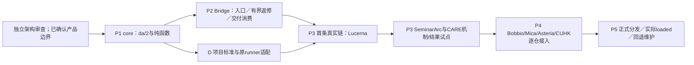

# 逐阶段落地、验收、维护与成本合同

本文件是同一研究的实施设计，**不是可执行Goal、生产修改或资源授权**。D1–D6的路线已由Planner选择，实施者不再决定是否换入口、如何消费失败、怎样发现旧行为或兼容哪一版接口。独立Critic审这些既定选择；真实宿主/七仓实验验证其运行性质。原P0“再研究六项架构问题”的计划撤销。

## 1. 顺序、依赖与进入条件

P0编号仅为历史映射兼容保留，现表示**运行能力核验**：01 D1的宿主负例、03 D2/D3/D4的发现/观察/接收机制和da/2拒绝矩阵；它不再拥有任何未裁决架构。P0核验随P1/P2/P3相应能力一同执行，不阻止其它可独立实施的低风险部分，但未证入口不能标支持。依赖图是语义依赖，不授权新分支、并行任务或七仓一揽子修改。

选Lucerna为首个完整试点：有真实provider链、现有native acceptance/候选绑定与已知状态错误，能同时证入口、旧保护、真实对象与同任务消费。它比先做新验收平台少引入执行面。Windows授权暂不可用时继续P1/P2的隔离机制和各项目只读适配设计；不得把替代环境通过冒充Lucerna实际完成。SeminarArc补跨进程持久化，CARE补科学负结论和长任务身份；四个其余仓仍各自通过，不能由三例替代。

每包共同交付条件：同一冻结目标→正常入口→好例可完成→真实坏例被拒→反馈由原owner实际接收→在原预算内修复→旧能力保持→最终对象/报告一致。文件、parser单测和文档数量均不足。

## 2. P1：workflow-core纯函数和接口

**代码归属。** AI_Skills_Collection canonical `skills/core/codex-system/codex-workflow-protocol/`；新增 `scripts/delivery_core.py`、da/2 schema/fixtures/reference，沿已有 `scripts/build_codex_marketplace.py`生成正式消费层。Bridge只读取安装绑定，不复制领域阈值。确切开工branch/worktree由后续已授权项目流程指定，本稿不创造分支。

**确定功能。** compile_obligations/discover_surface/select_checks/validate_result/evaluate_claim；输入输出与嵌套必填字段见03 D2/D6/F1/F4；partition_request先保存全文范围映射，ReceiptLocator不含待生成回执摘要。只做文件/数据语义计算，无设备、网络、模型调用、进程调度或发布效果。请求的语义投影来自当前模型，并绑定原文，不能以schema通过证明语义没有遗漏。

**验证。** 枚举以下成对fixture：真实需求缺runner、空adapter、动态未知边、删除/rename、已提交与未跟踪变更、shared dependency、正常文档无影响、标准冲突、同候选有效复用、collector变更失效、未跑/skipped/neutral、FAIL与UNKNOWN并存、不同target拼绿、da/1只诊断、未知主版本、重复JSON键、path escape、字段缺失/清空required、循环receipt。好例必须保留合法复用，坏例不得以FULL或退出0变绿。历史反例作为其中输入，不声称这些fixtures是七仓真实实测。

**接收和回滚。** Bridge同进程/精确entry调用消费结构化返回；项目adapter回报专业结果。core异常不输出READY，留具体错误与可独立继续项。回退上一验证组合；若无旧da/2组合，停发DA ready，保留项目原测试和全部未决义务。旧da/1不能被自动回写新语义。

**资源护栏。** 首轮纯机制测试使用本地合成/公开fixture、无外部服务；新增纯函数总CPU每小任务目标≤1秒、端到端增量p95≤5秒（不含现有产品测试和模型推理）。这些是本设计选择的工程验收目标，尚未量测；达不到则修缓存/算法或撤该新增层，不修改产品质量标准。

## 3. D包：项目/专业标准与现有运行器

D-LUC/D-BOB/D-MIC/D-SEM/D-AST/D-CUH/D-CARE沿04列出的当前合同、runner和现有专业owner。每包只增加最小Descriptor/ProjectAdapter/result转换、确实缺失的校准/回归。不是建立七个新验收平台，也不按26能力族各生成模块。

标准已有但缺程序：当前Executor收到VALIDATOR_MISSING及原条款、允许写路径、正常entry、good/bad/missing/unchanged，补原类别并由冻结校准验证。新类别只在能力/失败含义/观察/正常入口/owner/claim确有区别时创建。标准本身不明确或冲突回原专业Planner，不让Executor自定科学阈值。领域共用能力只有出现第二个真实消费者且标准一致时，才沿原专业plugin owner提炼；本设计不强制新增领域plugin。

通过条件：原runner确实运行、原始观察与result一一对应、解析不能把NOT_EVALUATED吞成PASS、坏collector不会迫使正确产品改坏。项目owner维护参数和生命周期，core维护通用格式；二者不交换判定权。暂停/退休须保留旧保护迁移与消费者适配，不能删配置就结束。

## 4. P2：Bridge原入口和真实消费

**修改位置已选。**

|现有位置|新增能力|下游与否决|
|---|---|---|
|cli.py::build_parser/run_lite_task/_lite_task_prompt|delivery prepare/ingest/check/ack/report；原函数内run_delivery_cycle；JSONL精确thread id与有界resume|当前Codex及原父进程；无id/换id/取消后启动必须拒绝|
|reviewed_runner.py::executor_prompt/run_codex_event/watcher_once|注入feedback；event内同一cycle；发布候选前check|原Reviewer和watcher；不伪造新REVISE，不清event attempt|
|agent_flow.py::RuntimeAdapter/launch_executor_with_preflight/plan_transition/apply_transition/build_parser|具体CodexExecRuntimeAdapter、Executor/Verifier各自preflight、consume_delivery_result、一次性control step、delivery predicate|已启动原Controller工具回合；只有route字典不算消费，无owner不声称后台|
|新增delivery.py/delivery_hooks.py|来源绑定、launch lease＋短state mutex、结果/收据解析、可信原生事件薄适配|当前回合/原任务；Hook只返回递送请求，须实际后续ack|
|原项目profile与安装收据|delivery_assurance.runtime_binding：精确core entry、payload/version/digest|缺绑定STOP／CORE_UNAVAILABLE；不从PATH或任意缓存选择相似脚本|

**预算确定。** 普通新增DA机械任务默认最多两次实际修复；Hook与父进程共享，不是2+2。run_delivery_cycle默认额外自动续修墙钟总上限30分钟，单个无输出Hook最多2秒；已有task更小上限优先。用户批准的正式长任务仍沿其原预算，不因30分钟截断Slurm作业；DA只停止额外自动launch并保留原job/owner。没有明确长期资源授权不启动。资源上限不是自动可花额度，账号/设备/付费仍逐effect受限。Stop处理器不得在2秒内执行专业检查，只读已准备的摘要；超时不代表平台会强制停止，交付端独立拒绝缺证。

**恢复/并发。** 用03 F3的launch lease、短state mutex和manifest提交点，父进程不得持短锁等child ack；不依赖fcntl支持Windows；网络共享/跨host多owner不支持自动续修，沿原合法handoff。launch intent先保存，崩溃后检查精确session、进程启动身份和结果再决定，不重复副作用。用户取消传递原进程组并冻结cancel epoch；旧结果可留审计，不能复活任务。所有文件owner字段是来源记录，非权限边界。

**必须运行的机制矩阵。** 正常接收修复、Hook缺席/未信任/超时/畸形输出、空block理由、错task/candidate、重复feedback、结果部分写入、resume换thread、父进程崩溃、用户Interrupt、原预算耗尽、外部stale review、无Controller、外部正常等待。每例一次初跑与一次针对性复跑上限，不为凑覆盖无限重试。Windows Native、目标Unix/Remote、Desktop/CLI分别记录版本与支持等级；GPT Work无已证等价接口，不伪装支持。

**效果和回退。** 此包不动Host授权、账号、scheduler、网络服务或任务状态枚举；Persistent保持原寿命职责。真实安装/信任设置另需授权。失败可退回原launcher行为，停止DA语义通知，保留恢复点；退出码只报进程事实。外部GPT正常等待至少两小时宽限且健康时继续等待，不消耗repair轮次，也不把等待改BLOCKED。

## 5. P3：桌面、移动与科学三条完整链

### P3-LUC

修改现有development-acceptance/acceptance-preflight结果消费和provider-state回归；正向目标为真实刷新与旧Codex/OpenAI/Longleaf状态保持。good动态两输入；bad固定值/缺值归零/旧PID；collector错误先修采集。结果回当前Executor，原独立native流程保留三轮与角色隔离；不额外创建Reviewer。最终必须同EXE/hash/PID与真实provider后置状态。机械、真实桌面和账户动作的精确上限见04 D5。回退DA适配保留安全断言/旧回归，不动VPN/SSH/安装偏好。用户仍需自己发现假刷新则否决。

### P3-SEM

适配run-blackbox-acceptance和verify-gpt-work；复用B02/B03/B04/B07与Room migration。正向创建/编辑/结束→强停→重开读回；坏UI假保存、错OCR控件、导出缺媒体必须正确区分。APK/serial/素材/签名绑定，动态skip保持NOT_EVALUATED。失败返回当前Executor，修产品后重跑旧媒体/录音，修collector则重采。模拟器不证明物理麦克风/OEM；缺设备权限不能换目标。回退保留数据与有效回归，清数据仅精确测试实例且有恢复备份。

### P3-CARE

**首轮路线已经选择**：先回放现有反偷懒/adequacy/finalizer结果和最多10个变异，CPU小fixture连续3+2步与独立resume2步比对，60秒上限，GPU/Slurm提交0。它验证DA机械判断、同任务反馈与科学负结论路由，不声称验证真实训练充分性。

真实科学验收复用之后合法活动task的formal entry/model/pretrained/split/scale/最低时长/总体和资源，不从历史Route B或CARE ASE14000步中任选替代。当前R2 v9等待与Attempt3归档不授权恢复旧route。按03 F2适配finalizer送审材料出口和原科学Controller最终结果消费，不把packet可生成视为科学成功；packaging场景必须archive save/load后官方entry，不只工作镜像。科学充分负结果交原Planner，不能继续训练直到正面；no-T2/split/权重等不可偷换。

这里未填新GPU数量是科学/资源授权不在本研究范围，**不是把DA架构留给实现者**：接口已经要求原task预算和实际计数，缺合法budget就拒绝launch。在下一个批准科学task运行前绑定其具体值，不新增科学路线。回退不取消job、不删checkpoint、不上传或邮件外传。

## 6. P4：其余四仓具体实施包

|包|基线与改动|真实验收/坏例/旧保护|接收、权限、回退|
|---|---|---|---|
|P4-BOB|develop a64edfd；Safe runner保留0.2Reader保护，0.3原milestone聚合出口加check；真实zotero_client read/authorize/mutate|隔离批注往返、PDF不变/cache重建；真实dataDir污染与旧0.2签0.3拒绝；论文切换/Inspector保持|当前Executor/runner owner；最多两测试论文/隔离profile；不动真实库，回退DA仍保留隔离断言|
|P4-MIC|rebuild0aee22f；acceptance CLI/validator/Parent接收，release-config→manifest→loaded|Foundation→LowMemory→Highlighter→PDF；真实A/B/C分别process/heap；错anchor/缩负载/功能关闭不算过；typing/IME/branch保持|原Parent/当前Executor；正常Edge账号最终手动，禁止自动化规避；退候选扩展保留dist稳定路径，未证登录态不签完成|
|P4-AST|193c033；routeGestalt/rc19RouteGestalt/基线diff/结果适配|独立真实几何＋完整科学图；常量0/缺ratio/已提交保护变更拒绝；trace、关系与canonical导出保持|原Executor与独立科学/视觉owner；固定URL身份需真实核验，部署另授权；退适配不删旧bad与科学约束|
|P4-CUH|9f25c775；parent-delivery-gate纯谓词外的原调用方/hosted audit结果/Parent消费|可见注册关键路径＋claim/auth/state/finalize事务；fetch旁路、burn、混snapshot拒绝；隐私、只读重入、并发保持|原campaign owner；测试persona和snapshot限额见04；换snapshot关旧campaign，新活动仍须授权；回退DA不擅改生产DB/token|

四包的普通功能压力推演与完整source直链见04；不能只换项目名复用Lucerna验收。一个项目装好DA不等于另一个项目已能用。

## 7. P5：正式分发、消费者维护与回退

中央source→生成→正式release→installed→loaded→normal entry逐层证明。Bridge开发分支不直接当release；AI Skills不直接修cache；生产plugin新runtime验收使用既有有界plugin-replay合同，精确输入与权限先冻结。本研究不执行该replay，也不创建任务。

da/2按03 D6先reader/fixtures、再Bridge握手、再单仓shadow和单一准入权、再逐consumer推广，最后同步PIE相邻设计与已安装清单。da/1只诊断；未知reader拒绝DA ready。shadow结果与原runner不一致必须归因，不能直接用新总绿覆盖旧红。每consumer绑定源/生成payload/安装host/实际CODEX_HOME/loaded版本和入口；复制文件、改version或中央release不等消费者完成。

维护板只用原TODO/DOING/ADAPTING/DONE。中央已发布、消费未证时ADAPTING；没发现的机器不被全局DONE覆盖。任务开始、依赖更新、公共入口变更、交付前触发有效性检查，不新增定时后台。incident先定位产品/标准/程序/collector/入口/身份/传输，转原owner最小修复并增加正式坏例；不每遇故障新增组件。

暂停必填owner、范围、原因、期限和替代；到期在下一次入口/交付校验，required仍未证不能ready。永久退休迁移旧保护与consumer alias或有明确原目标取消授权。退出DA前确保原项目runner仍可正常调用、原任务恢复点完整、证据可读；再移除接点。产品数据/部署回滚不包含在插件回滚权限中。

## 8. 成本、试验规模与净收益否决

目前没有实测节省比例、token/时间或价格；不写虚假“节省80%”。统一记录：一次性接入人工分钟/模型token/运行时；每任务增量CPU、墙钟、模型调用、设备/GPU和用户主动操作；维护升级/失败回退分钟；真正避免的提醒/搬运和首轮用户发现缺陷次数。价格在执行时核实实际供应商计费；本设计不调用付费API。

**一次投入的计划估算，不是承诺工期：** P1需要1组schema/算法/负例集；P2需要4类入口接线（原生、Lite、Review、Control）及2种OS机制回放；每仓D包是1个适配器＋现有runner补洞，不预设新增Gate数；P5是7仓逐项加载与回退证据。人工审阅/实现工作量粗估公共层40–80小时、每仓8–24小时、首次发行/兼容8–16小时，合计104–264小时；估算包含代码与机制验证，不含等待真实设备/账号/外部审查，也不含新科学训练。以首次两包实测更新估算；超过上界先缩小公共层或重新比较路线A，不自动扩预算。

**工程比较规模固定：** 每仓4个任务类型（普通功能、共享旧行为、小文档、环境/权限缺失），共28个案例；每仓选1个最高风险坏候选，共7个；其中旧功能按03 D2独立抽3项/仓。可在同候选隔离副本配对旧流程A与新流程B，顺序交叉；真实账号/训练不为统计重复，沿原批准运行采证并说明不可配对。每案例初跑＋最多1次特定修复复跑用于评估；不得借评估另领产品修复预算。这是工程否决集，不是统计证明可靠率。

**默认节流已经决定：** 日常语义投影用当前模型上下文，不新增专用模型；小文档不额外启动Reviewer/设备/GPU；纯函数目标CPU≤1秒、增量p95≤5秒；复杂任务昂贵检查在稳定候选运行且复用有效观察；Hook最多2秒；普通额外自动续修最多2次、总30分钟。未知测量不是0成本。04逐仓设备数量/时间与零外部效果默认值共同适用。

**停止推广条件：** 任何最高风险坏候选签高等级完成、未授权效果、用户取消后重启、科学降级当等价，停止该接点扩展并修复。B必须减少至少一条旧流程实际漏掉的风险链或减少用户提醒/搬运；只多回执无结果收益就撤新增层。小改频繁FULL先修discovery/缓存，无法改善回退项目原路径。总成本增加只有在明确风险收益和原预算内才可接受，不凭“保障”无限消耗。

## 9. 运行证据与设计决定的界线

本轮已确定最小架构、各入口消费者、发现/选测、观察层级、da/2迁移、七仓实验和维护成本。尚未发生独立Critic审查、生产实现、宿主事件实测、七仓真成品验收或正式发行。原生Hook缺席下强制阻止聊天文本是已证明的平台能力缺口，不能靠P0试验承诺修掉；用户已接受这一有限文字边界并排除新客户端；当前无待用户决定的架构产品问题。

后续报告必须讲用户得到的实际能力、受验对象、新增/加固/复用checks、真正运行/合法未运行、同任务修复和仍需用户动作。研究材料可审查和产品可交付不是同一层；不把当前包写成执行批准。

## 10. 最小完整投入选择与逐阶段用户收益合同

**裁决：不把104–264小时当成应一次批准的整体工程。** 最强的便宜替代是只给七仓现有runner补坏例和结果读取；当主要失败来自单仓断言缺失、不会跨入口丢失身份或失败无人接收时，它更划算。此处历史还反复出现原生请求漏验收、低层PASS冒最终就绪、同任务未消费和跨候选拼绿，因此选择一个可退出的完整纵向切片先证公共层价值，再按前文已决定的设计展开。不是将Review/Control或其余六仓的架构留给后续决定，也不是以试点代替七仓交付。

首片固定为：P1最小da/2 reader/evaluator、原请求覆盖、入口/旧保护闭包；P2原生与Lite的接入/共享预算/最终check；D-LUC与P3-LUC正常功能→真实成品→旧功能→失败同任务修复。先只实现这个闭合子集，未包含的Review/Control/其它项目明确未启用DA，原工作流仍有效。首片计划估算28–64小时，属于总体估算的子集而非额外加项；需实际设备/账号的部分仍按04精确授权后运行。无桌面授权可完成机制准备，但不能标首片用户收益通过。首片失败先修或撤公共新增层，不默认启动跨七仓铺开。

104–264小时只有在减少真实高代价事故与用户负担时才值得。仅用省人工时间的假设作量级判断：若每任务净省20分钟，忽略维护也需约312–792个任务回收一次投入；首片约84–192个。这个算式不是已测收益，账号污染、错误科学结论等损失也不能凭空换成金额。首两包记录增量与维护后重算；如果主要只多回执而未消除一条旧漏检/搬运链，选择退回项目runner补强路线，并保留有用坏例。若真实收益成立但维护超上限，先减公共抽象/重复字段处理，不能减真实验收承诺来制造收益。

|重点链|必须直接观察的用户收益|不能偷换的完成线|
|---|---|---|
|P3-LUC|从无手动提醒的普通请求发现缺检查；动态坏值/旧provider回归被拒；当前Executor实际收到反馈并修复；同EXE/PID与后置状态才准最终claim|只fixture或准备包通过不算真实桌面/账号链|
|P3-SEM|无提醒选出保存/重启/导出保护；假保存及错采集分流；同APK/serial重跑；实际收到文本与原本意输入分别报告|基础设施READY_TO_PASTE_PARENT、模拟器结果或harness读回都不能冒全部真实硬件/字符输入|
|P3-CARE|机械试点不把validator PASS+adequacy FAIL报告成有效方法；失败返回原Controller；保留同task/job/预算；不重提已运行作业|10个变异与CPU3+2步只关闭协议/机制试点；科学用户收益须以后合法完整训练/评价task的真实身份、规模、负结论与Planner消费，未有该任务前保持未验证|

所有试点同时记“用户主动提醒次数、搬运次数、首个发现者、实际repair接收/执行/结果”，没有观测到就记UNKNOWN；不从模型自述推断0。独立旧入口抽样和遗漏要求注入在候选冻结后执行，标准先冻结，不能挑成功样本。

**零新增运行的确定条件。** 纯知识问答且无修改/成品承诺时，现有模型直接答复；即使已有Hook也只做轻量身份/NONE判断，不建GateResult或模型审查。简单文档修订只做相关内容/链接/渲染约束，不跑产品设备；完全没有受管交付目标就没有交付claim。完全未启用的host不运行DA也不标DA自动保障。已启用受管交付始终check，不能用“这次没Hook”免除。

**零额外自动续修的确定条件。** 用户取消/暂停、授权缺失、新专业标准待裁决、外部审查正常等待、长作业仍在运行、session/effect状态未知或原预算已耗尽，均不launch。两次/30分钟仅为待试点检验的保守默认上限，取与原任务剩余额度的较小值；不是付费额度。初次实现、等待和记账不偷算成修复，也不能换任务洗掉真实修复计数，详03 F3。

**每包的交接与否决。** P1给Bridge原维护者格式/fixture与负例证据；P2给同一原任务真实调用返回与OS故障结果；D/P3/P4给各项目原owner同候选专业观察与Claim；P5给已有维护流程逐consumer实际loaded/回退证据。未通过包只阻其依赖，不能写全局DONE。全部接点按03 F2单一Bridge.check_delivery消费：exit0且requested claim READY才通过；exit2保留明确非就绪；exit3为接口/身份错误。实际合法平台能力与性能是这些包的否决条件，不再留未选架构。
