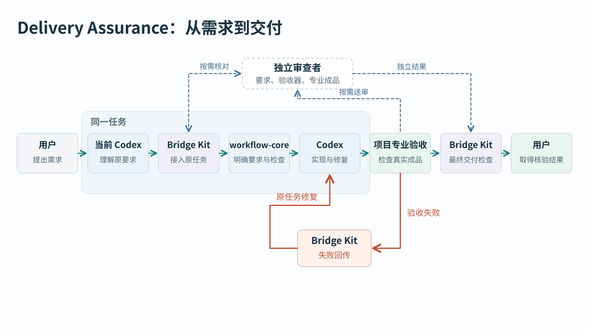

# Delivery Assurance：从一句普通请求到可信交付

**架构设计已获独立 Critic R3 的 PROCEED；系统尚未实施。** 审查对象是包 `7ca0f0f2c84cc9f29ec8df525797d17da168bd7b`、架构源 `79fe13a6ce3480732e206b33029cfa3b9fcf9a78`。本说明展开同一方案，不改变 02–06 的技术合同。R3 结论由用户在当前任务转交，没有独立 GitHub 审查文件。

它要改变的是：用户说完要什么以后，Codex 自己发现该验什么，验到真实成品；失败回到正在做这件事的任务；缺证据时，正常结束入口不接受“已经完成”的报告。用户不再承担日常提醒、找漏项和转抄错误的工作。但没有合法独立角色通道、没有宿主接点或任务已经无人接收时，系统必须明确说明限制，不能把人工交接画成自动。

## 一张图先看完整路径

[可追溯 SVG 图源](11_DELIVERY_ASSURANCE_ARCHITECTURE.svg)。图中的 A1–A9 对应下文函数表。蓝色是已冻结、尚待实现的连接；绿色是已有项目代码或角色合同，**不表示 DA 已接通**；橙色虚线表示必须实测的宿主能力或授权条件。图里所有“自动”均以这些条件成立为前提。

## 从 Lucerna 的真实问题开始

真实历史材料是 Lucerna 的 [01054 原任务](https://github.com/YuukiAS/Lucerna/blob/79dd2875d3da33c6a6d80e5e35bea812b84c1ceb/prompts/tasks/01054_final_independent_release_acceptance.md)及 [LR-STATE-001 修复记录](https://github.com/YuukiAS/Lucerna/blob/79dd2875d3da33c6a6d80e5e35bea812b84c1ceb/results/01054_final_independent_release_acceptance/repair-product-001.md)。当三条访问路由中两条可用、Tailscale 仍在检查、Bridge 或 VS Code 只是没有观测结果时，旧实现可能把整体升级为故障。用户看到的不是一个小措辞问题：明明仍能连接，却会以为系统坏了。

源码将“明确故障”和“未观测”分开处理：[longleaf.rs](https://github.com/YuukiAS/Lucerna/blob/79dd2875d3da33c6a6d80e5e35bea812b84c1ceb/src-tauri/src/longleaf.rs#L1889)的 `is_confirmed_secondary_problem/has_unobserved_evidence` 决定后端含义，[longleaf-presentation.ts](https://github.com/YuukiAS/Lucerna/blob/79dd2875d3da33c6a6d80e5e35bea812b84c1ceb/src/longleaf-presentation.ts#L44)的 `isUnobservedComponent/bridgeSideCopy/vscodeCopy` 决定读者看到的状态。已有[回归](https://github.com/YuukiAS/Lucerna/blob/79dd2875d3da33c6a6d80e5e35bea812b84c1ceb/scripts/test-longleaf-presentation.mjs)还保留“真实故障必须继续警示”的对照。

下面把该真实任务中的这个子问题表达为普通请求：“修正 Longleaf 状态：检查中不能算故障，已有可用连接别被误报；真正的故障仍要提示。”这是**据历史任务整理的说明输入，不是伪造用户原话**。成功和失败两条链是冻结架构的设计推演，不是本轮已经运行的结果。历史修复记录也只声明 Producer 定向验证，不能替本方案证明独立原生验收已经完成。

## 1. 先保存用户到底要什么，再决定谁核对

普通请求无需先写 Goal。受支持的原生入口在收取请求时调用 `prepare_admission`，保存完整原文、引用材料、当前仓库与任务、已有权限、预期产物；第一次相关产品写入前再次消费准入选择。Lite、Review、Control 则在各自已有启动边界做这件事。权限仍由原宿主和原任务合同执行，DA 不能给自己加权。

这条 Lucerna 请求不只有“把红色改成绿色”。至少包括：未观测不等于坏、检查中不等于坏、已证故障仍警示、标题/摘要/详情一致、旧配额和通知行为不退化。原文覆盖能发现漏段落，却不能保证模型理解正确，所以有两个入口：

- **已冻结标准下的局部机械修复**可以由当前 Executor 自查。例如按现有状态表修一个映射，不改观察来源和状态含义。简单 UI 修正不自动升级重型 Review。
- **新增状态含义、观察来源、专业判断或重要风险**时，现有独立 Reviewer、Verifier 或科学 Planner 必须从原始材料重新建立后置条件，不能只看 Executor 的摘要。已有同范围、仍有效的独立决定可复用。

系统不是笼统“再叫一个 agent”。本机项目 Reviewer 只有在已有该角色、当前授权和宿主只读工具边界均成立时，才由 `run_admission_review → run_project_reviewer_once` 启动有限进程，结果经精确 JSONL 身份回到仍在运行的父任务，再由 `consume_requirement_review` 消费后放行相关写入。角色无候选写权限，输入包含完整原文、标准和必要源码；同用户文件可读不等于严格文件读取隔离。

Review 的 `init_task()` **仅建 PLAN_REQUESTED 文件**。只有已经启用、范围匹配的原安排任务实际运行 Planner，并由原 watcher 收到新结果，才是自动核对。Control 也必须有可运行的具体原角色，抽象 `RuntimeAdapter` 不算。缺通道时可以继续不依赖该判断的阅读、定位和准备；高风险依赖写入及相应 USER_READY 等待原角色，保留同任务恢复点。系统不能暗中让用户搬运一份失败报告，却声称自动闭环。

## 2. 不只选验收，也要求开发时用上成熟能力

`select_execution_capabilities` 根据任务选择相关能力，Bridge 把实际安装版本、完整合同或工具入口交给当前 Executor；后者须留下实际读取/调用以及对实现的影响。只有“已安装某插件”或“读过名字”不算使用。

本例优先使用项目已有的状态语义、Longleaf 回归和原生产品审查能力。若实际修改视觉层级，再加载相关前端能力；不会因为仓库有 UI 就给一个后端映射修复强加完整前端流程。项目等效成熟实现可以替代指定插件，但要说明为什么等效、谁实际消费了它。必要能力不可用时可做诊断或准备，不能把低配替代偷偷签成原要求已完成。

同时，`discover_surface/compile_obligations/select_checks` 从正式入口、已接受基线及变化前后依赖图决定需要哪些检查。删除一段旧代码不能让对应保护消失；未知依赖保留为未证。本例因此不仅验“检查中不报错”，还验真正故障仍提示、重复刷新不抖动，以及受共享状态影响的旧配额和通知。不是每次跑七仓全部检查，也不是只信手写 adapter 的清单。

## 3. 缺验收器时补验收器，但产品作者不能随手批准自己的答案

Bridge 把缺失义务、原标准、允许修改范围和控制集交回当前 Executor。Executor 在原项目补候选验收器，而不是另建长期 Validator Agent。

候选走 `CANDIDATE → CALIBRATING → ACTIVE`。校准使用四种冻结控制：正确实现、故意错误实现、缺少观察、应保持的旧行为。本例的“永远显示 Available”必须在真实故障控制中被识别；完全没读到数据不能被补成健康；真实故障提示也不能为了修假警报被删掉。

低风险机械规则只有在标准、控制和准入政策事先冻结时才可自动批准。新增专业判断、观察方法、阈值或首次支持重要最终交付，须原独立角色批准。它可用获权的只读进程执行，但“换一个模型”本身不是独立性。候选摘要、四控制、校准结果、批准权威、激活摘要和实际回执写入 `DefinitionAdmission`，只有准确匹配的 ACTIVE 版本能支持 USER_READY。校准结果不是产品交付结果。

ProjectAdapter 首次接入也走同一准入；之后先影子读取原结果、不签就绪，再从正常入口验证好例和绕过坏例，才能启用。更改标准、控制、观察器或正式出口会使相应准入/结果失效。暂停检查不会取消原义务，退休要迁移旧保护。

## 4. 真正验的是用户拿到的东西

项目原有 runner 产生专业事实；DA 只检查事实是否足够支撑这次声明，不负责替七个领域打一个万能分数。

对 Lucerna，已有 `development-acceptance.ps1` 中的 `Assert-CandidateAdmission/Test-SmokeCaptureEligibility/Test-CaptureSameRunBinding` 能绑定候选、smoke 与截图。这只是材料和运行资格。完整产品交付还要遵守原[独立原生验收合同](https://github.com/YuukiAS/Lucerna/blob/79dd2875d3da33c6a6d80e5e35bea812b84c1ceb/docs/workflows/LUCERNA_INDEPENDENT_RELEASE_ACCEPTANCE.md)：精确 source/EXE/hash/PID、对应 preflight、Reviewer 自己的交互与整屏观察、当前范围内全部 mandatory gates。Producer 截图、旧 PID 或“脚本退出 0”都不能代替。

本例的机械多状态控制证明映射规则；实际候选窗口证明用户看到的标题、摘要、详情一致、刷新不抖动，并由独立 Reviewer 消费原始观察。若某状态只在 fixture 出现，只能报告该状态的机制证据，不能谎称真实在线状态已出现。真实账号、网络、远程环境等动作须原授权；本轮一个也没有运行。

|项目|最终专业结果由什么证明|明确不能冒充最终结果的材料|
|---|---|---|
|Lucerna|同一原生候选、独立交互/整屏观察、状态和旧功能结果|Producer 程序绿、旧 EXE/PID、只有 preflight|
|Bobbio|当前里程碑独立产品审查、隔离 Zotero 原生批注往返、PDF 不变与性能|旧 0.2 Safe 结果代 0.3，或准备包代最终原生验收|
|Mica|当前实际加载版本、范围内 Foundation/LowMemory/Highlighter/PDF、正常 Edge 操作结果|candidate bundle、关功能换低内存、未加载的新源码|
|SeminarArc|同 APK/签名/设备，输入、保存、强停重开、所需媒体导出及原 Parent 结果|READY_TO_PASTE_PARENT、跳过动态检查、模拟器代未测硬件|
|Asteria|实际 URL 上完整科学图、关系与几何/交互，原 Parent 各项判断|静态全零、旧网页截图、仅模型 JSON|
|CUHK_Date|当前 source/Web/API/snapshot，真实注册和 claim→auth→state→finalize，原 Parent 消费|发票/预检成功、旧 snapshot、只 fetch 页面|
|CARE|原科学合同下真实模型/数据/规模/checkpoint/指标、Controller 核查与必要 Planner 结论|validator 绿、短跑冒完整训练、packet 冒科学有效|

七仓的原结果文件和准确接点见 [04](04_SEVEN_REPOSITORY_ADOPTION.md#r2-ar04)。专业边界不能互相代签；科学充分负结果可形成“实验完成，方法未成立”的报告，不能强迫返修到正面才结束。规模不足也不能借“负结果”逃避原任务。

## 5. 错误返回正在干活的任务，不靠用户转述

假设 Executor 为消除假警报，把所有 Longleaf 状态都改成 Available。正常控制可能通过，冻结的真实故障控制应失败。反馈携带原要求、候选身份、实际/期望、原始证据和允许修复范围；当前工具直接返回给 Executor。若在结束检查发现，受支持 Stop 返回同任务继续指令；Lite 的原父进程只按实际 JSONL 中的精确 thread/session 恢复，禁止 `--last` 或另开任务冒充恢复。

Executor 修正共享状态含义，保留“未观测是未知，已证故障仍提示”，再跑受影响的旧保护；新源/EXE 使相关旧观察失效，Reviewer 重新观察当前对象。若其实是截图采到旧 PID，修采集器并重采，不把正确产品改坏；若标准冲突则回原 Planner，不能改 expected 让测试变绿。

普通新增自动返修共享上限为两次、额外墙钟 30 分钟，并取原任务剩余额度的较小值；Hook 与父进程不能各领一份。原 Lucerna 三轮专业审查不是额外叠加额度。取消、权限缺失、外部正常等待、副作用状态不明时不再启动。等待不耗修复轮次。父进程不持短锁等子进程回执；恢复先核真实 effect/session，不能因同 thread 就假定可安全重做。

父任务消失以后只保存原任务恢复点，不承诺自动唤醒。用户以后恢复该任务时，系统先读已有专业结果和收据，再决定补什么；不让用户重新拼上下文。没有后台服务，因此这一边界是明确的。

## 6. 最后一道检查由正常结束入口强制执行

这正是 R2 修订最关键的变化：不再寄望七个历史脚本各有一个 finalizer，也不寄望模型记得运行某条命令。

正常 host 必须无条件调用同一个拟新增 `finish_delivery`，即使 Executor 没提供 manifest、只写了 result 文件就结束。它按准入登记的原结果位置构造提交，读取专业结果，调用 `check_delivery`，生成报告，再由 `accept_submission` 核对候选、声明、报告字节与实际完成事件；只有完整一致才接受相应交付。普通聊天已经发出的文字不是可撤回事务，DA 不承诺抹除它。

材料可以先到 `REVIEW_BUNDLE_READY` 供 Reviewer 审；最终 `USER_READY` 必须等专业结果被实际消费。这避免“必须先过审才能生成送审包”的循环。结果和回执按固定顺序落盘，不把将来的回执 hash 写进自己的输入。

Lucerna 的正常成功链应是：原文后置条件完整 → 合适能力实际使用 → 所需检查已激活 → 同候选真实观察及独立审查成立 → 正常 Stop/Lite 退出触发检查 → 报告接受。坏链的反证是：**省略全部显式 finish，直接把原 result 写成完成并结束；缺当前独立结果时，正常 host 仍拒绝受管 USER_READY，并把失败交回原任务。** 只在测试里手动调用 check 得到拒绝，不算证明这条保障。

原始 result 是生产者草稿。用户报告在原任务证据根的 `delivery_assurance/report.md`，另有绑定 manifest；保留原结果路径，不新建任务库。报告用人话说明完成了什么、哪个对象被验过、哪些旧行为保持、还有什么未证明。正确报告可写“当前材料已齐，仍待独立原生验收”，不能把准备工作写成最终可用。

## 7. 图中箭头到底对应什么

“现有”只表示固定源码或原角色合同存在；“拟新增”表示 R3 已批准的设计，尚未实施。函数定义、参数、原子顺序及 da/2 字段以 [03](03_END_TO_END_EXECUTION_AND_VALIDATORS.md) 为唯一技术权威。

|箭头|调用者 → 被调用者 → 实际接收者|状态与失败处理|
|---|---|---|
|A1 请求/首次写入|拟新增 `delivery_hooks.py::on_prompt/on_pre_tool_use → delivery.py::prepare_admission`；已有 `cli.py::run_lite_task` 等启动边界接同入口 → 当前任务|新增接线；Hook 实测前不承诺。原文/身份/权限缺失不放行依赖写入|
|A2 独立核对|拟新增 core `decide_admission_route` → Bridge `run_admission_review/run_project_reviewer_once` → `consume_requirement_review` → 当前 owner|需真实只读角色及授权；Review 由原安排任务启动、原 `watcher_once` 收回；`init_task` 本身不启动|
|A3 能力/旧保护|拟新增 core `select_execution_capabilities/discover_surface/compile_obligations` → Bridge 绑定版本与 ACK → 当前 Executor|按相关性触发；读取证据与实际影响分开。未知旧义务不能删掉|
|A4 补验收定义|拟新增 Bridge `submit_definition/calibrate_definition/activate_definition`，core `validate_definition_admission` → 原准入权威/ACTIVE 索引 → 选测者|候选只能校准；四控制/独立批准缺失不能激活；adapter 同规则|
|A5 运行/观察|拟新增 core `select_checks` → 项目已有 runner、原独立 Reviewer → adapter/GateResult → Bridge `ingest_result`|真实对象、专业标准归项目；错 PID/缺观察不能支持 claim|
|A6 失败/恢复|Bridge 结构化反馈 → 当前工具返回或拟新增 `on_stop/run_delivery_cycle` → 原 Executor/原父进程|有当前 owner 才自动；精确 session、共同预算、取消与 effect 去重；否则原任务恢复点|
|A7 强制完成|拟新增 `on_stop`；现有 `run_lite_task/run_codex_event` 退出处、`watcher_once.consume_pending_delivery`、Control `apply_transition` 终态前 → `finish_delivery`|这些是待接线；结果文件存在不替实际 host。Control 的 `validate_executor_result` 仅验 Executor 阶段|
|A8 判定/报告|拟新增 `materialize_submission → ingest_result → check_delivery → report → accept_submission` → 当前 host 原终态消费者|没有显式 manifest 仍检查；READY/REPAIR/WAIT/STOP 与提交是否接受分开；缺身份为接口错误|
|A9 用户结果|host 接受后 → 原任务最终回复链接 `report.md/report.manifest.json`|不改原项目用户接受/部署权限；不接受时只给诚实未完成/等待报告|

固定 Bridge 源码核对入口和七仓具体路径见 [07](07_INDEPENDENT_CRITIC_PACKAGE.md)。这里没有声称源码中已经存在上述新增函数。旧脚本只产生专业结果，最后接受结果的是新增共享入口及其真实 host 调用者。

## 8. 哪些能够自动，哪些仍需要人，哪些现在还做不到

|路径|冻结的承诺|前提或限制|
|---|---|---|
|普通低风险请求|自动相关能力/选测，当前任务接失败并修复|对应 host 已探测、接线、启用；纯问答可 NONE，不启动整套验收|
|高风险事前核对|复用原项目 Reviewer，或已存在且获权的 Review/Control 通道|角色必须真的运行并返回；不能仅靠 prompt 或一个任务目录|
|账号、设备、模型额度、部署|只执行原任务明确获权的精确动作|DA 不新增授权；没有权限就停依赖动作，其它合法工作继续|
|Hook 缺席/失效|受管出口仍可强制检查；原生聊天自动保障可能不可用|不能撤回已经生成的错误聊天文字；不另造客户端补洞|
|原任务结束/owner 退出|保存身份、反馈、收据和恢复位置|不承诺后台唤醒或替用户开启任务|
|GPT Work 手工 Parent / Mica 正常 Edge 短操作|明确保留原合法边界|Asteria、SeminarArc 等没有自动通道证据时仍有一次原 Parent 交接；不称全链零人工|
|Windows Desktop、CLI、Remote|按实际版本逐项证明后启用|当前 P0 均未运行；一个宿主通过不替另一个签名；七仓 DA enabled 全部为 NO|

## 9. 为什么不做更大平台，怎样判断值不值得继续

只补七仓现有测试最便宜，但不能独自解决普通请求漏触发、结果无人消费、跨候选拼绿和结束报告绕过。另造客户端或总调度平台又会增加权限、运行和维护面。因此只在 **Bridge、workflow-core、项目 adapter** 三处接线，专业判断仍归原项目。

成本估算保持 R3 冻结值：先行 P0 **4–8 小时**；首个完整 Lucerna 切片 **40–88 小时（含 P0）**；全量 **138–332 小时**。这是规划，不是实际投入或费用授权；原产品测试、外部等待和新科学运行另记。

先证明宿主，再做最小 Lucerna 完整链。必须实际看到不靠提醒选择验收、坏实现被拒、原任务收到反馈并修好、正常结束接受当前报告，而且旧功能保持。只多了文件和回执、没有减少漏检或用户搬运，就不推广。撤回新增公共层时保留项目有效回归、原结果和未完成义务，不能用停用 DA 把未证任务变成完成。

## 10. 此刻的证据等级与下一步

已有证据是固定源码、历史任务/修复记录、R3 独立设计结论，以及本轮解释文件的读回；不是 DA 运行证据。正常 Hook、精确 resume、角色实际权限/返回、结束强制检查、七仓 adapter 和真实产品链均待实施及验证。

[12 分阶段实施审查稿](12_STAGED_EXECUTION_REVIEW_PACKAGE.md)把已通过设计压成先行 P0、最小 Lucerna 切片和后续逐仓合同。[08](08_CRITIC_PROMPT.md)是下一轮独立审查入口。研究提交、图源和审查稿均不启动执行，也不授权产品、账号、设备、付费、GPU 或部署。
