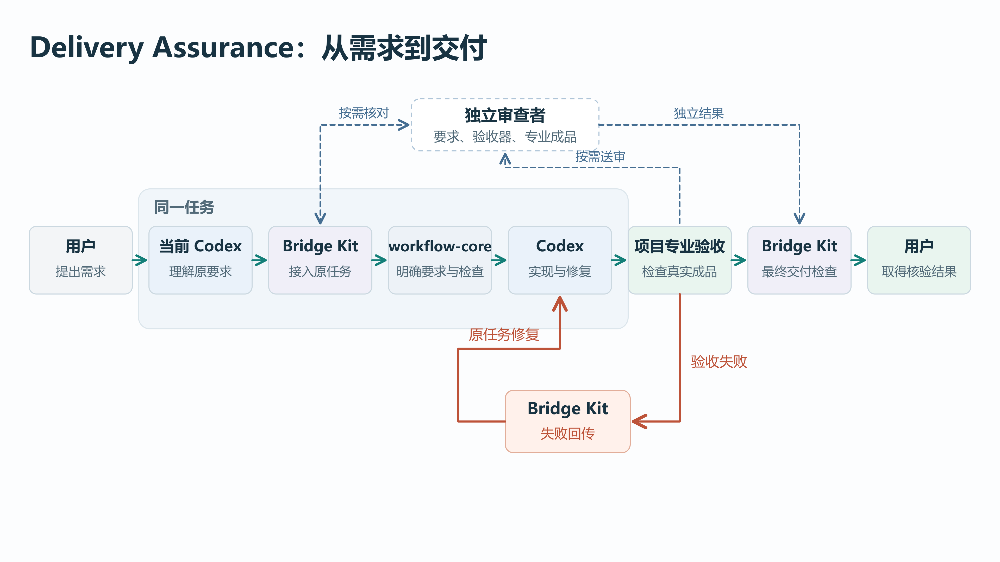
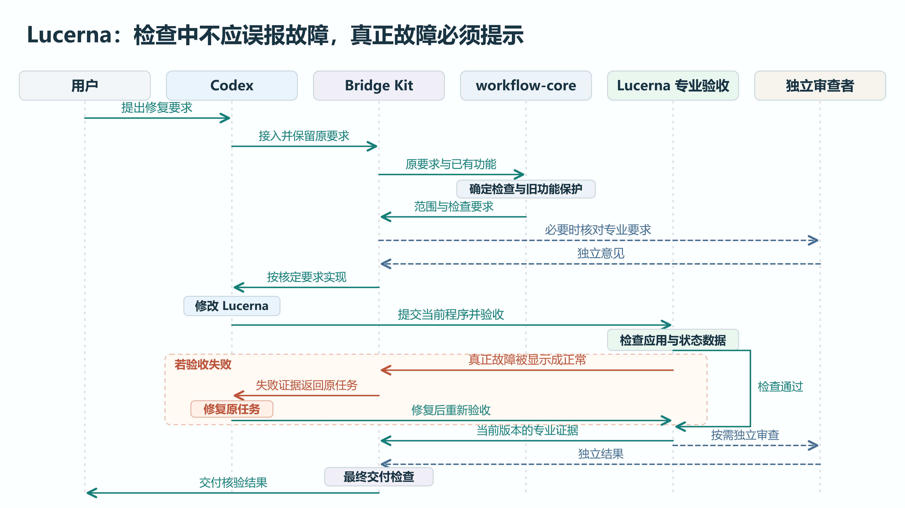

# Delivery Assurance：系统架构与 Lucerna 执行路径

## 为什么需要这套系统

Codex 写完代码、跑过测试，并不代表交到你手里的软件已经符合要求。它可能一开始理解漏了，也可能只测新功能而做坏旧功能，或者测试通过了，实际窗口仍显示错误。检查结果如果没有回到原任务，最后就变成你发现问题、要求补验收、再催促修复。

Delivery Assurance 把这些责任接进普通任务：先明确要求和旧功能保护，再检查真实成品；失败交回原 Codex 修复，证据齐全后才接受交付。你仍然照常提出需求。**这套架构已通过设计审查，图中的新接线和完整执行路径尚未实施、验证。**

## 图一：系统由谁负责，按什么顺序协作

[高清图片](11_DELIVERY_ASSURANCE_ARCHITECTURE.png) · [可编辑图源](11_DELIVERY_ASSURANCE_ARCHITECTURE.svg)

沿绿色箭头从左向右看：用户提出需求，当前 Codex 接到请求，Bridge Kit 接入原任务，workflow-core 确定必须满足的要求和检查，Codex 实现，项目验收程序检查真实成品，Bridge Kit 做最终交付检查，用户取得核验结果。

这是逻辑协作顺序。同名的 Codex 表示原任务在接收需求和开发阶段的两次出现；几个 Bridge Kit 方框表示同一套程序在接入、失败回传和最终交付时承担不同工作，不是新建多个服务或聊天任务。图中 workflow-core 到 Codex 的箭头表示检查要求交给实现者；实际由 Bridge Kit 调用规则库、接回结果并交给当前 Codex，规则库不会自己启动模型。

|部分|负责什么|
|---|---|
|Codex|理解原要求，使用相关专业能力，修改产品，收到失败证据后继续修复|
|Bridge Kit|保留原请求和任务身份，传递要求，接回结果，把失败送回原任务，控制最终交付|
|workflow-core|根据已整理的原要求、项目标准和已有功能，决定必须做到什么、保护什么、检查什么，并核验检查与证据的使用资格|
|项目专业验收程序|运行项目自己的检查，观察实际软件、数据、交互和最终成品，产生专业证据|
|独立审查者|在必要时独立核对原要求、验收器或专业成品；不接手产品开发|
|用户|提出目标，作出确实需要本人的授权，取得结果与证据|

workflow-core 是普通共享规则库，不是另一个 AI。自然语言要求由当前 Codex 整理；重要含义、专业标准或观察方式可能被误解时，再由已有独立角色读取原始材料核对。规则库依据这些输入作出可检查的选择，不能凭空创造专业标准。

图上的蓝色虚线表示按需独立审查。标准已经明确的低风险机械修复可以自查，不必每次都等待另一位审查者。真正需要独立核对时，Bridge Kit 或项目原有的合法调用者负责启动和接收；项目成品到审查者的箭头表示送交审查材料。只生成审查文件、不运行审查者，也没有人接回结果，不能算完成独立核对。

**旧功能保护与成熟能力在实现前确定。** 项目提供已接受的标准、正式入口和依赖关系，workflow-core 据此选出受影响的旧行为和所需检查。相关成熟能力也在此时交给 Codex：需要确认实际读取或调用，并说明对实现产生了什么作用。普通后端或文档任务不会因此被强制套用完整前端流程。

**检查程序也需要先证明可靠。** 缺少验收器时，当前 Codex 可以补候选程序，但它要先通过冻结的正确、错误、缺证据和旧功能对照。重要专业判断还须由已有独立权威批准。只有获准的准确版本能支持最终交付，不能产品和测试一起改松后自行宣布有效。

橙红色回路表示项目验收发现问题，把证据交给 Bridge Kit，再回到原 Codex 修复；修好后沿主路径重新验收。它让失败报告有明确接收者。最终 Bridge Kit 检查当前版本是否满足必需条件，生成并接受相应报告。受支持的正常结束入口也必须消费这项检查，不能让 Codex 直接写一句“完成”绕过它。

### 角色与任务的边界

Bridge Kit 和 workflow-core 都是程序，不是子代理。项目验收脚本也不因为名字中有“验收”就具有独立审查身份。

已有项目审查角色需要独立上下文时，冻结设计允许有授权的本机单次只读 Codex 子进程，由活跃父任务消费其准确身份和结果。原生子代理只有在项目已有同等机制、权限也允许时才可作为载体，不默认新增通用代理组。要求核对不获得运行产品、设备或账号的额外权限；审查者不能修改候选产品、标准或受保护答案。

已有外部规划或审查任务则由原有安排机制启动、原接收者取回结果。若交接后换了执行会话，应明确记录它仍属于同一逻辑任务，不能称作恢复了同一条原生聊天。图二展示的是原 Codex 保持接收责任的路径；外部交接的差异不被混入这条泳道。

## 图二：Lucerna 的一次任务怎样执行

[高清图片](12_LUCERNA_EXECUTION_FLOW.png) · [可编辑图源](12_LUCERNA_EXECUTION_FLOW.svg)

六条泳道从左到右是用户、Codex、Bridge Kit、workflow-core、Lucerna 专业验收、独立审查者。时间从上向下，横向箭头表示要求或结果交给谁。右侧绿色路径表示检查通过；橙红色区域表示失败后返回原任务，再次验收。虚线审查消息只在需要时发生。

**历史问题有实际记录。** Lucerna 曾在三条访问路线中已有两条可用、另一条仍在检查时，因为部分辅助状态尚无观察结果而把整体误判为故障。界面也可能同时显示“不可用”和“检查中”。历史修复记录包含定向修改和测试，但明确没有在那轮重新构建、启动 Windows 正式候选，也没有完成新的独立界面验收。因此，它能说明问题从哪里来，不能证明 Delivery Assurance 已经运行。

图中以下过程都是已审设计的预期执行，不是已发生的验收结果。

你提出“检查中不应误报故障，真正故障必须提示”。Codex 经 Bridge Kit 保留这份原始要求。workflow-core 根据整理后的要求和项目标准，明确检查范围：尚未查明不能当作已经故障；已确认故障必须继续提醒；已有可用连接与正确状态不能被修坏；标题、摘要和详情应表达一致含义。需要独立核对时，由 Bridge Kit 接回专业意见后再交给 Codex 实现。

Codex 修改 Lucerna 后，专业验收程序检查本次准备交付的应用和状态数据。检查规则的测试、受控状态对照和真实窗口观察各有用途：对照可以发现状态判断错误；实际窗口可以发现“数据说故障、画面说正常”以及交互或成品不一致。不能用测试通过替代真实成品观察，也不能把受控对照说成在线环境已经出现过的每种故障。

正常路径中，检查中的部分不会误报故障，已经可用的连接保持正确展示，真正故障仍会提醒。受影响的旧功能、当前成品和必要的独立检查都满足要求后，Bridge Kit 才接受交付。

失败路径使用一个故意错误的实现作为反例：为了消除假警报，把真正故障也显示成正常。专业验收应识别这种不一致，把实际结果、应有结果和证据交给 Bridge Kit；Bridge Kit 再把它送回同一 Codex 任务。这里没有“等用户先发现，再搬运错误报告”的步骤。

Codex 修复状态判断后，重新运行相关检查并观察修改后的应用。旧截图、旧版本的独立意见不能替新版本作证。图中最后的专业证据和独立结果都应与当前候选一致；最终交付检查成立，用户才收到结果。若再次失败，仍按原任务的权限与预算继续处理，不会因为已经修过一轮就自动放行。

## 哪些已经确定，哪些尚未实现

**设计已经通过，运行能力尚未证明。** 普通入口自动接入、独立角色的实际启动与返回、同任务恢复、正常结束时强制检查和七仓适配，都还需要实施与验证。已有项目代码、历史测试和本次图片渲染不能替这些新能力作证。

先行宿主验证要证明 Windows 桌面、命令行和远程环境各自能否可靠接入、返回反馈、恢复准确任务，以及取消或退出后不会重复动作。随后才是最小 Lucerna 完整试点和其余项目逐项接入。一个平台可用不代表所有平台可用。

缺少必要观察、合法独立审查通道或外部环境支持时，应明确说明未完成的部分。新增账号、设备、GPU、付费或部署动作仍需原有授权。自动返修受原任务预算限制，用户取消后不能继续；没有活跃接收者时保存证据和恢复位置，不能承诺后台自行唤醒。原生接入机制完全缺席时，也不保证撤回已经生成的错误完成文字。

本次只重做原研究目录中的两张图、说明和对应索引，未修改批准的技术方案、生产代码或实施草稿，未运行产品或宿主探针，未启动角色、子代理、新任务或审查。

## 来源说明

两张图保留可编辑 SVG，并实际渲染为 3840 × 2160 PNG。完整画面与缩小预览均用于检查中文、箭头、角色归属和返修路径；这只属于图片交付检查。

- **设计依据：** 独立第三轮设计审查结论由用户在本任务中转交；没有单独的 GitHub 审查原文。被审包为 [7ca0f0f](https://github.com/YuukiAS/AI_Research_Toolkit/commit/7ca0f0f2c84cc9f29ec8df525797d17da168bd7b)，冻结架构源为 [79fe13a](https://github.com/YuukiAS/AI_Research_Toolkit/commit/79fe13a6ce3480732e206b33029cfa3b9fcf9a78)。本次没有重新设计或发起架构审查。
- **请求、检查与返修的技术追溯：** 冻结源中的 [02 整体架构](https://github.com/YuukiAS/AI_Research_Toolkit/blob/79fe13a6ce3480732e206b33029cfa3b9fcf9a78/docs/research/software-production/22_DELIVERY_ASSURANCE_GLOBAL_WORK_RESEARCH_20261022/WORK_OUTPUT/02_ARCHITECTURE_AND_COMPONENTS.md)、[03 完整调用合同](https://github.com/YuukiAS/AI_Research_Toolkit/blob/79fe13a6ce3480732e206b33029cfa3b9fcf9a78/docs/research/software-production/22_DELIVERY_ASSURANCE_GLOBAL_WORK_RESEARCH_20261022/WORK_OUTPUT/03_END_TO_END_EXECUTION_AND_VALIDATORS.md)。架构图的目标核对对应拟新增 `prepare_admission/run_admission_review/consume_requirement_review`；能力选择与验收定义对应 `select_execution_capabilities/select_checks` 和 `submit_definition/calibrate_definition/activate_definition`；失败返回对应 `on_stop/run_delivery_cycle`；结束检查与报告对应 `finish_delivery → check_delivery → report → accept_submission`。这些是已冻结、待实施的接线，不能当成已存在且已验证的能力。
- **七仓专业出口、权限与恢复：** 冻结源中的 [04 七仓接入](https://github.com/YuukiAS/AI_Research_Toolkit/blob/79fe13a6ce3480732e206b33029cfa3b9fcf9a78/docs/research/software-production/22_DELIVERY_ASSURANCE_GLOBAL_WORK_RESEARCH_20261022/WORK_OUTPUT/04_SEVEN_REPOSITORY_ADOPTION.md)和 [06 分阶段实施](https://github.com/YuukiAS/AI_Research_Toolkit/blob/79fe13a6ce3480732e206b33029cfa3b9fcf9a78/docs/research/software-production/22_DELIVERY_ASSURANCE_GLOBAL_WORK_RESEARCH_20261022/WORK_OUTPUT/06_IMPLEMENTATION_AND_EVALUATION.md)。本次未修改技术合同或实施草稿。
- **Lucerna 历史事实：** 固定源码 `79dd2875d3da33c6a6d80e5e35bea812b84c1ceb` 下的 [原任务](https://github.com/YuukiAS/Lucerna/blob/79dd2875d3da33c6a6d80e5e35bea812b84c1ceb/prompts/tasks/01054_final_independent_release_acceptance.md)、[修复记录及尚未完成的验收边界](https://github.com/YuukiAS/Lucerna/blob/79dd2875d3da33c6a6d80e5e35bea812b84c1ceb/results/01054_final_independent_release_acceptance/repair-product-001.md)、[后端状态处理](https://github.com/YuukiAS/Lucerna/blob/79dd2875d3da33c6a6d80e5e35bea812b84c1ceb/src-tauri/src/longleaf.rs#L1889)、[界面状态处理](https://github.com/YuukiAS/Lucerna/blob/79dd2875d3da33c6a6d80e5e35bea812b84c1ceb/src/longleaf-presentation.ts#L44)、[对应回归检查](https://github.com/YuukiAS/Lucerna/blob/79dd2875d3da33c6a6d80e5e35bea812b84c1ceb/scripts/test-longleaf-presentation.mjs)和[独立产品验收合同](https://github.com/YuukiAS/Lucerna/blob/79dd2875d3da33c6a6d80e5e35bea812b84c1ceb/docs/workflows/LUCERNA_INDEPENDENT_RELEASE_ACCEPTANCE.md)。
